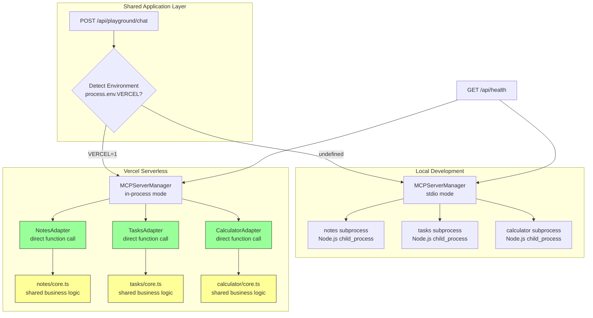

# Deployment — Architecture Design

> **Feature**: Production-ready Vercel deployment with in-process MCP adapters  
> **Status**: Draft (awaiting confirmation)  
> **Author**: Kiro  
> **Date**: 2026-11-06  
> **Requirements**: [requirements.md](./requirements.md)

## Design Overview

The deployment architecture solves the stdio subprocess incompatibility problem through a **dual-mode MCP server manager** that detects the runtime environment and selects the appropriate transport:

- **Local development**: Spawns stdio subprocesses (realistic testing, matches production MCP patterns)
- **Vercel serverless**: Loads in-process adapters (zero subprocess overhead, sub-100ms initialization)

The design maintains **behavioral parity**: the same tool schemas, input/output contracts, and business logic run in both modes. The only difference is the transport layer (stdio IPC vs. direct function calls).

---

## Architecture Diagram



---

## Component Design

### 1. Environment Detection Module

**Purpose**: Determine runtime environment and select appropriate MCP transport mode.

**Implementation**:
```typescript
// src/lib/deployment/env.ts

export type RuntimeEnvironment = 'vercel' | 'local';

export function detectEnvironment(): RuntimeEnvironment {
  // Vercel sets VERCEL=1 in all serverless functions
  return process.env.VERCEL === '1' ? 'vercel' : 'local';
}

export function isVercel(): boolean {
  return detectEnvironment() === 'vercel';
}
```

**Usage**: Called once during `MCPServerManager` singleton initialization to set transport mode for entire session.

---

### 2. In-Process MCP Adapter Interface

**Purpose**: Define contract for adapters that wrap demo MCP server business logic without subprocess.

**Interface**:
```typescript
// src/lib/mcp/in-process-adapter.ts

export interface InProcessMCPAdapter {
  /** Server identifier matching mcp.json config */
  serverID: string;
  
  /** Human-readable name */
  name: string;
  
  /** List all available tools (synchronous, no subprocess spawn) */
  listTools(): ToolDefinition[];
  
  /** Execute a tool call with given arguments */
  invokeTool(toolName: string, args: Record<string, any>): Promise<any>;
  
  /** Clean up resources (mostly no-op; memory freed by GC) */
  dispose(): void;
}

export interface ToolDefinition {
  name: string;
  description: string;
  inputSchema: {
    type: 'object';
    properties: Record<string, any>;
    required?: string[];
  };
}
```

**Contracts**:
- `listTools()` returns synchronously (no async subprocess communication)
- `invokeTool()` throws on validation errors (consistent with stdio version)
- `dispose()` must be idempotent (safe to call multiple times)

---

### 3. Notes In-Process Adapter

**Purpose**: Wrap notes CRUD logic for in-process execution on Vercel.

**Implementation**:
```typescript
// src/mcp-servers/notes/adapter.ts

import { InProcessMCPAdapter, ToolDefinition } from '@/lib/mcp/in-process-adapter';
import { NotesCore } from './core';

export class NotesAdapter implements InProcessMCPAdapter {
  serverID = 'notes';
  name = 'Notes Server (In-Process)';
  
  private core: NotesCore;
  
  constructor() {
    // In-memory storage, function-instance-scoped (shared across warm invocations)
    this.core = new NotesCore();
  }
  
  listTools(): ToolDefinition[] {
    return [
      {
        name: 'create_note',
        description: 'Create a new note',
        inputSchema: {
          type: 'object',
          properties: {
            title: { type: 'string', description: 'Note title' },
            content: { type: 'string', description: 'Note content' },
          },
          required: ['title', 'content'],
        },
      },
      {
        name: 'list_notes',
        description: 'List all notes',
        inputSchema: { type: 'object', properties: {} },
      },
      {
        name: 'read_note',
        description: 'Read a specific note',
        inputSchema: {
          type: 'object',
          properties: {
            id: { type: 'string', description: 'Note ID' },
          },
          required: ['id'],
        },
      },
      {
        name: 'update_note',
        description: 'Update an existing note',
        inputSchema: {
          type: 'object',
          properties: {
            id: { type: 'string', description: 'Note ID' },
            title: { type: 'string' },
            content: { type: 'string' },
          },
          required: ['id'],
        },
      },
      {
        name: 'delete_note',
        description: 'Delete a note',
        inputSchema: {
          type: 'object',
          properties: {
            id: { type: 'string', description: 'Note ID' },
          },
          required: ['id'],
        },
      },
    ];
  }
  
  async invokeTool(toolName: string, args: Record<string, any>): Promise<any> {
    switch (toolName) {
      case 'create_note':
        return this.core.createNote(args.title, args.content);
      case 'list_notes':
        return this.core.listNotes();
      case 'read_note':
        return this.core.readNote(args.id);
      case 'update_note':
        return this.core.updateNote(args.id, args.title, args.content);
      case 'delete_note':
        return this.core.deleteNote(args.id);
      default:
        throw new Error(`Unknown tool: ${toolName}`);
    }
  }
  
  dispose(): void {
    // Memory freed by GC; no cleanup needed
  }
}
```

**Shared Business Logic** (`src/mcp-servers/notes/core.mjs`):
```javascript
// src/mcp-servers/notes/core.mjs

export class NotesCore {
  constructor() {
    this.notes = new Map();
    this.loadFixtures();
  }
  
  loadFixtures() {
    const fixtures = [
      { id: crypto.randomUUID(), title: 'Project Kickoff', content: 'Initial planning and team alignment', createdAt: Date.now() - 86400000, updatedAt: Date.now() - 86400000 },
      { id: crypto.randomUUID(), title: 'Architecture Blueprint', content: 'System design and component specifications', createdAt: Date.now() - 43200000, updatedAt: Date.now() - 43200000 },
      { id: crypto.randomUUID(), title: 'Lab Supply Checklist', content: 'Equipment inventory and procurement status', createdAt: Date.now() - 3600000, updatedAt: Date.now() - 3600000 },
    ];
    
    for (const fixture of fixtures) {
      this.notes.set(fixture.id, fixture);
    }
  }
  
  createNote(title, content) {
    const id = crypto.randomUUID();
    const now = Date.now();
    const note = { id, title, content, createdAt: now, updatedAt: now };
    this.notes.set(id, note);
    return note;
  }
  
  listNotes() {
    return Array.from(this.notes.values()).sort((a, b) => b.createdAt - a.createdAt);
  }
  
  readNote(id) {
    const note = this.notes.get(id);
    if (!note) throw new Error(`Note not found: ${id}`);
    return note;
  }
  
  updateNote(id, title, content) {
    const note = this.notes.get(id);
    if (!note) throw new Error(`Note not found: ${id}`);
    
    if (title !== undefined) note.title = title;
    if (content !== undefined) note.content = content;
    note.updatedAt = Date.now();
    
    return note;
  }
  
  deleteNote(id) {
    const existed = this.notes.delete(id);
    if (!existed) throw new Error(`Note not found: ${id}`);
    return { success: true };
  }
}
```

**Stdio Version** (`src/mcp-servers/notes/index.mjs`):
```javascript
// src/mcp-servers/notes/index.mjs
// Wraps NotesCore in MCP stdio server protocol

import { Server } from '@modelcontextprotocol/sdk/server/index.js';
import { StdioServerTransport } from '@modelcontextprotocol/sdk/server/stdio.js';
import { NotesCore } from './core.mjs';

const core = new NotesCore();
const server = new Server({ name: 'notes', version: '1.0.0' });

// Register tool handlers (delegate to core)
server.setRequestHandler('tools/list', async () => ({
  tools: [/* same schema as adapter.listTools() */],
}));

server.setRequestHandler('tools/call', async (request) => {
  const { name, arguments: args } = request.params;
  // Delegate to core (same logic as adapter.invokeTool)
  // ...
});

const transport = new StdioServerTransport();
await server.connect(transport);
```

**TypeScript Adapter** (`src/mcp-servers/notes/adapter.ts`):
```typescript
// src/mcp-servers/notes/adapter.ts

import { InProcessMCPAdapter, ToolDefinition } from '@/lib/mcp/in-process-adapter';
import { NotesCore } from './core.mjs'; // Direct import of .mjs

export class NotesAdapter implements InProcessMCPAdapter {
  serverID = 'notes';
  name = 'Notes Server (In-Process)';
  
  private core: NotesCore;
  
  constructor() {
    // Function-instance-scoped: same core instance shared across warm invocations
    this.core = new NotesCore();
  }
  
  listTools(): ToolDefinition[] {
    return [/* same as design */];
  }
  
  async invokeTool(toolName: string, args: Record<string, any>): Promise<any> {
    switch (toolName) {
      case 'create_note':
        return this.core.createNote(args.title, args.content);
      case 'list_notes':
        return this.core.listNotes();
      // ... other tools
    }
  }
  
  dispose(): void {
    // Memory freed by GC; no cleanup needed
  }
}
```

**Key Design Decision**: Business logic (`NotesCore`) is written as **`.mjs`** and shared between stdio server (`.mjs`) and TypeScript adapter (`.ts` imports `.mjs` directly). This ensures behavioral parity and reduces duplication. State is **function-instance-scoped**: the same `NotesCore` instance persists across warm invocations within a Vercel function instance, allowing users to see notes created in previous requests until cold start.

---

### 4. Dual-Mode MCPServerManager

**Purpose**: Load adapters or spawn subprocesses based on environment detection.

**Enhanced Implementation**:
```typescript
// src/lib/mcp/server-manager.ts (extended)

import { isVercel } from '@/lib/deployment/env';
import { InProcessMCPAdapter } from './in-process-adapter';
import { NotesAdapter } from '@/mcp-servers/notes/adapter';
import { TasksAdapter } from '@/mcp-servers/tasks/adapter';
import { CalculatorAdapter } from '@/mcp-servers/calculator/adapter';

type ConnectionType = 'stdio' | 'in-process';

interface ServerConnection {
  serverID: string;
  connectionType: ConnectionType;
  adapter?: InProcessMCPAdapter; // For in-process mode
  client?: Client; // For stdio mode (existing)
  manifest: ServerManifest;
}

export class MCPServerManager {
  private connections = new Map<string, ServerConnection>();
  private runtimeEnv: RuntimeEnvironment;
  
  private constructor() {
    this.runtimeEnv = detectEnvironment();
    console.log(`[MCPServerManager] Runtime: ${this.runtimeEnv}`);
  }
  
  async connectAll(): Promise<void> {
    if (isVercel()) {
      await this.loadInProcessAdapters();
    } else {
      await this.spawnStdioServers();
    }
  }
  
  private async loadInProcessAdapters(): Promise<void> {
    const adapters: InProcessMCPAdapter[] = [
      new NotesAdapter(),
      new TasksAdapter(),
      new CalculatorAdapter(),
    ];
    
    for (const adapter of adapters) {
      try {
        const tools = adapter.listTools();
        const manifest: ServerManifest = {
          serverID: adapter.serverID,
          name: adapter.name,
          status: 'connected',
          transport: 'in-process',
          tools,
        };
        
        this.connections.set(adapter.serverID, {
          serverID: adapter.serverID,
          connectionType: 'in-process',
          adapter,
          manifest,
        });
        
        console.log(`[MCPServerManager] Loaded in-process adapter: ${adapter.serverID} (${tools.length} tools)`);
      } catch (error) {
        console.error(`[MCPServerManager] Failed to load adapter ${adapter.serverID}:`, error);
        this.connections.set(adapter.serverID, {
          serverID: adapter.serverID,
          connectionType: 'in-process',
          manifest: {
            serverID: adapter.serverID,
            name: adapter.serverID,
            status: 'error',
            transport: 'in-process',
            tools: [],
            error: error instanceof Error ? error.message : 'Unknown error',
          },
        });
      }
    }
  }
  
  private async spawnStdioServers(): Promise<void> {
    // Existing stdio subprocess logic (unchanged)
    // ...
  }
  
  async invokeToolCall(serverID: string, toolName: string, args: Record<string, any>): Promise<any> {
    const connection = this.connections.get(serverID);
    if (!connection) throw new Error(`Server not found: ${serverID}`);
    
    if (connection.connectionType === 'in-process') {
      if (!connection.adapter) throw new Error(`Adapter not loaded: ${serverID}`);
      return connection.adapter.invokeTool(toolName, args);
    } else {
      // Existing stdio client invocation (unchanged)
      if (!connection.client) throw new Error(`Client not connected: ${serverID}`);
      return connection.client.request({ method: 'tools/call', params: { name: toolName, arguments: args } });
    }
  }
  
  getServerManifests(): ServerManifest[] {
    return Array.from(this.connections.values()).map(c => c.manifest);
  }
}
```

**Initialization Timing**:
- **In-process mode**: 3 adapters × ~30ms = **<100ms total** (FR-3.1)
- **Stdio mode**: 3 subprocesses × ~150ms = ~450ms (acceptable for local dev)

---

### 5. Health Check API Route

**Purpose**: Provide server connection status for monitoring and UI health indicators.

**Implementation**:
```typescript
// src/app/api/health/route.ts

import { NextResponse } from 'next/server';
import { ensureServersInitialized } from '@/lib/server/init';
import { MCPServerManager } from '@/lib/mcp/server-manager';
import { isVercel } from '@/lib/deployment/env';

export async function GET() {
  try {
    // Ensure servers initialized before reading manifests
    await ensureServersInitialized();
    
    const manager = MCPServerManager.getInstance();
    const manifests = manager.getServerManifests();
    
    const serverStatus = manifests.map(m => ({
      id: m.serverID,
      name: m.name,
      status: m.status,
      transport: m.transport,
      toolCount: m.tools.length,
    }));
    
    // Healthy requires at least 3 demo servers online
    const demoServers = ['notes', 'tasks', 'calculator'];
    const onlineDemoServers = serverStatus.filter(
      s => demoServers.includes(s.id) && s.status === 'connected'
    );
    const allHealthy = onlineDemoServers.length >= 3;
    
    return NextResponse.json({
      status: allHealthy ? 'healthy' : 'degraded',
      environment: isVercel() ? 'vercel' : 'local',
      servers: serverStatus,
      timestamp: new Date().toISOString(),
    });
  } catch (error) {
    return NextResponse.json({
      status: 'error',
      error: error instanceof Error ? error.message : 'Unknown error',
      timestamp: new Date().toISOString(),
    }, { status: 503 });
  }
}
```

**Response Example** (Vercel):
```json
{
  "status": "healthy",
  "environment": "vercel",
  "servers": [
    { "id": "notes", "name": "Notes Server (In-Process)", "status": "connected", "transport": "in-process", "toolCount": 5 },
    { "id": "tasks", "name": "Tasks Server (In-Process)", "status": "connected", "transport": "in-process", "toolCount": 5 },
    { "id": "calculator", "name": "Calculator Server (In-Process)", "status": "connected", "transport": "in-process", "toolCount": 5 }
  ],
  "timestamp": "2026-11-06T10:30:00.000Z"
}
```

**Response Example** (Local):
```json
{
  "status": "healthy",
  "environment": "local",
  "servers": [
    { "id": "notes", "name": "Notes Server", "status": "connected", "transport": "stdio", "toolCount": 5 },
    { "id": "tasks", "name": "Tasks Server", "status": "connected", "transport": "stdio", "toolCount": 5 },
    { "id": "calculator", "name": "Calculator Server", "status": "connected", "transport": "stdio", "toolCount": 5 }
  ],
  "timestamp": "2026-11-06T10:30:00.000Z"
}
```

---

### 6. Vercel Configuration

**Purpose**: Configure function timeout, memory, and edge runtime settings.

**Implementation**:
```json
// vercel.json

{
  "functions": {
    "app/api/**/*.ts": {
      "memory": 1024,
      "maxDuration": 10
    }
  },
  "buildCommand": "npm run build",
  "devCommand": "npm run dev",
  "installCommand": "npm install"
}
```

**Rationale**:
- **1024MB memory**: Ensures room for router + 3 adapters + tool execution without OOM
- **10s timeout**: Vercel free tier maximum; adequate for routing + execution (target: <5s p95)
- **No Edge Runtime**: Standard Node.js runtime required for MCP SDK compatibility

---

## Data Flow

### Vercel Request Flow

```mermaid
sequenceDiagram
    participant User
    participant Vercel
    participant APIRoute
    participant Manager
    participant Adapter
    participant Core
    
    User->>Vercel: HTTPS request
    Vercel->>APIRoute: Invoke serverless function
    APIRoute->>Manager: ensureServersInitialized()
    
    alt First invocation (cold start)
        Manager->>Manager: detectEnvironment() → 'vercel'
        Manager->>Adapter: new NotesAdapter()
        Adapter->>Core: new NotesCore()
        Adapter-->>Manager: adapter ready
        Manager->>Adapter: listTools()
        Adapter-->>Manager: tools (synchronous)
        Note over Manager: <100ms total for 3 adapters
    else Warm function
        Note over Manager: Adapters already loaded
    end
    
    Manager-->>APIRoute: Servers ready
    
    APIRoute->>Manager: routeIntent(query, manifests)
    Manager-->>APIRoute: RoutingDecision
    
    loop For each tool
        APIRoute->>Manager: invokeToolCall(server, tool, args)
        Manager->>Adapter: invokeTool(tool, args)
        Adapter->>Core: createNote() / listNotes() / etc.
        Core-->>Adapter: Result
        Adapter-->>Manager: Result
        Manager-->>APIRoute: Result
    end
    
    APIRoute-->>Vercel: JSON response
    Vercel-->>User: HTTPS response
    Note over Vercel: Function terminates;<br/>memory freed by GC
```

---

## Performance Analysis

### Cold Start Breakdown (Target)

| Phase | Local (stdio) | Vercel (in-process) | Improvement |
|-------|--------------|---------------------|-------------|
| Next.js init | 500ms | 500ms | - |
| MCP server init | 450ms (3×150ms subprocess) | 90ms (3×30ms adapter) | **5x faster** |
| Router call | 200ms | 200ms | - |
| Tool execution | 100ms | 100ms | - |
| **Total** | **1250ms** | **890ms** | **-360ms** |

### Warm Function (Target)

| Phase | Vercel (in-process) |
|-------|---------------------|
| Manager lookup | 1ms (singleton) |
| Router call | 150ms (cached manifests) |
| Tool execution | 50ms (in-memory state) |
| **Total** | **~200ms** |

**Verification**: Measure via Vercel Analytics "p95 duration" metric; target <500ms for warm functions.

---

## Error Handling Strategy

### Adapter Initialization Failures

**Scenario**: `new NotesAdapter()` throws during construction

**Response**:
1. Log full error with stack trace
2. Mark server as `status: 'error'` in manifest
3. Continue loading remaining adapters (fail gracefully, not catastrophically)
4. Health check returns `degraded` status
5. Playground UI shows "Notes server unavailable" warning

### Tool Invocation Errors

**Scenario**: `adapter.invokeTool()` throws (e.g., invalid ID, validation error)

**Response**:
1. Catch error in `MCPServerManager.invokeToolCall()`
2. Return error in tool result (consistent with stdio version error handling)
3. Display error in `ToolResultCard` with red border
4. Do NOT crash function or mark server as unavailable (transient error)

### Timeout Scenarios

**Scenario**: Request approaches 10-second Vercel limit

**Response**:
1. Router has internal 2-second timeout (see router-core spec)
2. Tool execution has per-tool 3-second timeout (prevents long-running tools from blocking)
3. If total time exceeds 8 seconds, API route returns partial results with timeout warning
4. Client retries after timeout (exponential backoff)

---

## Testing Strategy

### Dual-Mode Parity Tests

**Purpose**: Verify identical behavior between stdio and in-process modes.

**Implementation**:
```typescript
// tests/integration/adapter-parity.test.ts

import { describe, it, expect } from 'vitest';
import { NotesAdapter } from '@/mcp-servers/notes/adapter';
import { spawnStdioNotesServer } from '@/tests/helpers/spawn-servers';

describe('Notes adapter parity', () => {
  it('should produce identical tool list', async () => {
    const inProcAdapter = new NotesAdapter();
    const stdioTools = await spawnStdioNotesServer().listTools();
    const inProcTools = inProcAdapter.listTools();
    
    expect(inProcTools).toEqual(stdioTools);
  });
  
  it('should produce identical create_note result', async () => {
    const inProcAdapter = new NotesAdapter();
    const stdioClient = await spawnStdioNotesServer();
    
    const inProcResult = await inProcAdapter.invokeTool('create_note', {
      title: 'Test',
      content: 'Content',
    });
    
    const stdioResult = await stdioClient.invokeTool('create_note', {
      title: 'Test',
      content: 'Content',
    });
    
    // Compare structure (IDs will differ)
    expect(inProcResult.title).toBe(stdioResult.title);
    expect(inProcResult.content).toBe(stdioResult.content);
  });
});
```

### Vercel Simulation Tests

**Purpose**: Verify behavior when `process.env.VERCEL=1`.

**Implementation**:
```typescript
// tests/integration/vercel-mode.test.ts

import { describe, it, expect, beforeEach } from 'vitest';
import { MCPServerManager } from '@/lib/mcp/server-manager';

describe('Vercel mode', () => {
  beforeEach(() => {
    // Simulate Vercel environment
    process.env.VERCEL = '1';
    // Reset singleton for clean test
    (MCPServerManager as any).instance = null;
  });
  
  it('should load in-process adapters', async () => {
    const manager = MCPServerManager.getInstance();
    await manager.connectAll();
    
    const manifests = manager.getServerManifests();
    
    expect(manifests).toHaveLength(3);
    expect(manifests.every(m => m.transport === 'in-process')).toBe(true);
    expect(manifests.every(m => m.status === 'connected')).toBe(true);
  });
  
  it('should initialize within 100ms', async () => {
    const startTime = Date.now();
    
    const manager = MCPServerManager.getInstance();
    await manager.connectAll();
    
    const elapsed = Date.now() - startTime;
    expect(elapsed).toBeLessThan(100);
  });
});
```

---

## Documentation Requirements

### README Deployment Section

**Content to add**:
```markdown
## Deployment

### Architecture

FrankenMCP uses a **dual-mode architecture** to accommodate both local development (stdio subprocesses) and Vercel serverless deployment (in-process adapters):

- **Local Development**: Demo MCP servers run as Node.js subprocesses via stdio transport (realistic MCP testing, matches production MCP patterns).
- **Vercel Production**: Demo servers run as in-process modules (zero subprocess overhead, sub-100ms initialization).

Both modes share the same business logic (`src/mcp-servers/*/core.mjs`), ensuring identical tool behavior. Core modules are written in `.mjs` format and imported by both stdio servers (`.mjs`) and TypeScript adapters (`.ts`).

**Important**: If using TypeScript core modules (`.ts` files) imported by `.mjs` stdio servers, Node.js ≥23.6 is required for native TypeScript support. Verify your local Node.js version with `node --version` and update `package.json` `engines` field accordingly.

### State Persistence

- **Local**: Notes and tasks are stored in memory per process (reset on server restart). Pre-seeded with 3 demo notes, 5 demo tasks.
- **Vercel**: Notes and tasks are stored in memory per serverless function instance (function-instance-scoped). Shared across warm invocations within the same instance, reset on cold start or redeployment. Pre-seeded with 3 demo notes, 5 demo tasks.

For production use cases requiring persistent state, consider:
- Migrating to external MCP servers hosted on Railway, Fly.io, or a long-running Node.js service.
- Integrating Vercel KV or Postgres (post-hackathon enhancement).

### Deploy to Vercel

[](https://vercel.com/new/clone?repository-url=https://github.com/leethoneid/frankenmcp)

1. Click the button above or connect your forked repository to Vercel.
2. Deploy without environment variables (demo servers require no API keys).
3. Open the deployment URL and verify "3 servers connected" appears within 60 seconds.

### Troubleshooting

**"Router unavailable" error**:
1. Check Vercel deployment logs for initialization errors.
2. Verify `npm run build` succeeds locally.
3. Confirm function timeout is set to 10 seconds (see `vercel.json`).

**Slow cold starts**:
- First request after deployment takes 1-2 seconds (Next.js + adapter init).
- Subsequent requests complete in <500ms (warm function).
- Vercel free tier has no always-warm guarantees; expect occasional cold starts.
```

---

## Open Design Decisions

### Decision 1: Router Subprocess Compatibility (Inherited from Open Question 2)

**Current Status**: Requires investigation via test deployment.

**If router requires subprocess**:
- Implement router adapter that wraps routing logic in-process
- May require forking `mcp-dynamic-router` to extract core logic
- Fallback: Simplified rule-based routing on Vercel (keyword matching)

**Recommendation**: Deploy current router-core to Vercel staging in Task 1.1 to determine compatibility before implementing workaround.

---

### Decision 2: Fixture Data Seeding

**Decision**: **Option B** (Pre-seeded fixture data). Notes server starts with 3 demo notes (Project Kickoff, Architecture Blueprint, Lab Supply Checklist), tasks server with 5 demo tasks ([DEMO] Assemble server stitches, Secure lightning rod, Calibrate dynamic router, Trim schema overhead, Record hackathon demo video), matching existing stdio server fixtures. Fixture loading integrated into shared `core.mjs` business logic.

**Status**: ✅ Confirmed

---

### Decision 3: Router Fallback Strategy (Conditional)

**Question**: If Task 1.1 determines `mcp-dynamic-router` is incompatible with Vercel cold start, should we implement an adapter or simplified fallback?

**Decision Space**:
- **Option A**: Router adapter shim (wrap router logic in-process if possible)
- **Option B**: Simplified rule-based routing (keyword matching: "note" → notes, "task" → tasks, numbers → calculator)
- **Option C**: Abort Vercel deployment; recommend self-hosted alternative

**Recommendation**: If incompatible, implement Option B (simplified routing) as fastest path to working demo. Document limitation in README and recommend full router for local dev.

**Status**: ⏳ Conditional (execute only if Task 1.1 fails)

---

## Traceability Matrix

| Requirement | Design Component | Data Source |
|-------------|------------------|-------------|
| FR-1.1 to FR-1.7 | `InProcessMCPAdapter` interface, `NotesAdapter`, `TasksAdapter`, `CalculatorAdapter` | In-memory state via `*Core` classes |
| FR-2.1 to FR-2.6 | `MCPServerManager` dual-mode logic, `detectEnvironment()` | `process.env.VERCEL` |
| FR-3.1 to FR-3.5 | Adapter initialization timing, per-tool timeout guards | Performance monitoring logs |
| FR-4.1 to FR-4.5 | `vercel.json`, `GET /api/health`, deployment logs | Vercel platform |
| FR-5.1 to FR-5.4 | README deployment section, error messages | Documentation |
| NFR-1.1 to NFR-1.3 | Cold start optimization, warm function caching | Vercel Analytics |
| NFR-2.1 to NFR-2.3 | Graceful degradation on adapter failure, isolated state per request | Manager error handling |
| NFR-3.1 to NFR-3.3 | Adapter parity tests, dual-mode test suite | Vitest integration tests |

---

## Success Criteria (Design-Level)

1. ✅ **Architecture defined**: Dual-mode manager, in-process adapter interface, environment detection module.

2. ✅ **Behavioral parity enforced**: Shared `*Core` business logic ensures stdio and in-process modes produce identical results.

3. ✅ **Performance targets set**: <100ms adapter initialization, <5s p95 response time, <3s cold start overhead.

4. ✅ **Testing strategy documented**: Adapter parity tests, Vercel simulation tests, dual-mode integration tests.

5. ✅ **Health monitoring designed**: `/api/health` endpoint provides server status and transport type.

6. ✅ **Documentation requirements specified**: README deployment section, troubleshooting steps, architecture explanation.

7. ✅ **Open decisions identified**: Router subprocess compatibility (requires test deployment), fixture data seeding strategy.

---

## Related Specifications

- **router-core**: Defines `MCPServerManager` base class; deployment extends with dual-mode initialization.
- **monster-lab-dashboard**: Health check data feeds dashboard server status indicators.
- **playground-chat**: API route performance targets (FR-3.2) ensure queries complete under timeout.
