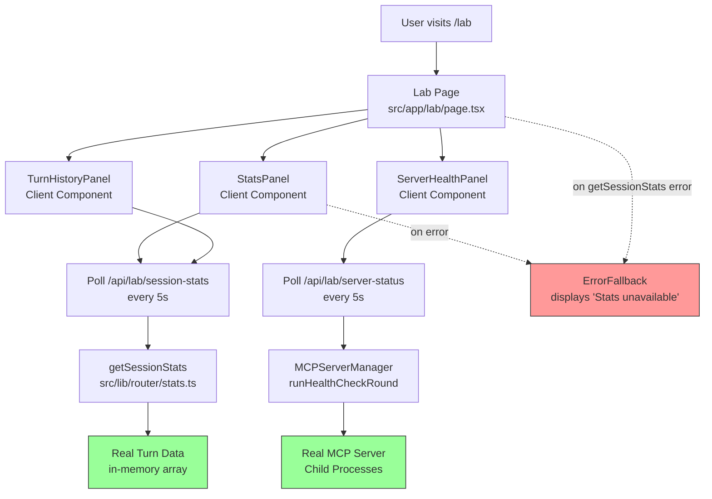
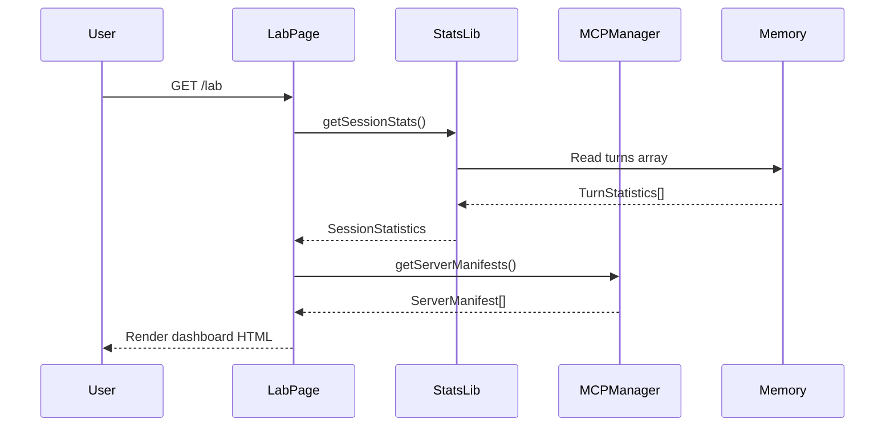
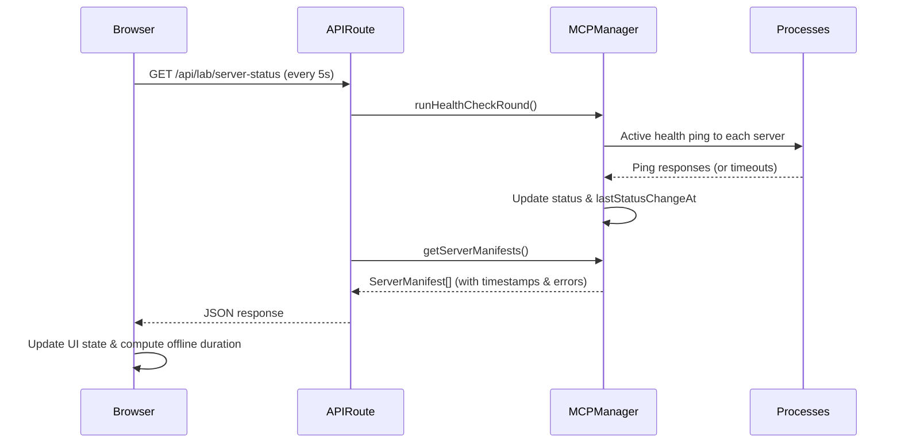

# Monster Lab Dashboard — Architecture Design

> **Feature**: Live dashboard visualizing per-turn routing decisions, schema trimming, and token savings  
> **Status**: Draft (awaiting confirmation)  
> **Author**: Kiro  
> **Date**: 2026-11-06  
> **Requirements**: [requirements.md](./requirements.md)

## Design Overview

The Monster Lab Dashboard is a Next.js App Router page that provides real-time visibility into FrankenMCP's routing decisions. It connects directly to the router statistics layer (`src/lib/router/stats.ts`) and server manager (`src/lib/mcp/server-manager.ts`) to display authentic, live data without any synthetic or hard-coded values.

The design prioritizes **transparency** (all numbers traceable to source), **fail-loud behavior** (errors displayed, never hidden), and **visual impact** (dark lab theme with prominent metrics).

---

## Architecture Diagram



---

## Component Hierarchy

```
src/app/lab/
├── page.tsx                    # Main dashboard page (Server Component)
├── layout.tsx                  # Optional: Lab-specific layout with dark theme
└── components/
    ├── StatsPanel.tsx          # Session aggregate statistics (Client Component, auto-refresh)
    ├── ServerHealthPanel.tsx   # Real-time server status (Client Component, auto-refresh)
    ├── TurnHistoryPanel.tsx    # Scrollable turn list (Client Component, auto-refresh)
    ├── TurnCard.tsx            # Individual turn details (Client Component, expandable)
    ├── MetricCard.tsx          # Reusable metric display (pure component)
    ├── ServerStatusBadge.tsx   # Status indicator with color coding (pure component)
    └── ErrorFallback.tsx       # "Stats unavailable" fallback UI
```

---

## Component Design

### 1. Main Dashboard Page (`src/app/lab/page.tsx`)

**Purpose**: Orchestrate all dashboard panels and provide initial server-side data.

**Implementation**:
- Server Component (default Next.js App Router)
- Fetches initial data server-side for faster first paint
- Client components handle auto-refresh via polling
- Try/catch handles statistics failures gracefully

**Code Skeleton**:
```typescript
// src/app/lab/page.tsx
import { getSessionStats } from '@/lib/router/stats';
import { MCPServerManager } from '@/lib/mcp/server-manager';
import StatsPanel from './components/StatsPanel';
import ServerHealthPanel from './components/ServerHealthPanel';
import TurnHistoryPanel from './components/TurnHistoryPanel';
import ErrorFallback from './components/ErrorFallback';

export default async function LabPage() {
  let sessionStats;
  let serverManifests;
  let statsError = null;

  try {
    sessionStats = getSessionStats();
    const manager = MCPServerManager.getInstance();
    serverManifests = manager.getServerManifests();
  } catch (error) {
    statsError = error;
  }

  return (
    <div className="min-h-screen bg-gray-950 text-gray-100">
      <header className="border-b border-green-900/30 px-8 py-6">
        <h1 className="text-4xl font-bold text-green-400">
          🧪 Monster Lab Dashboard
        </h1>
        <p className="text-gray-400 mt-2">
          Real-time routing transparency & context efficiency metrics
        </p>
      </header>

      <main className="px-8 py-6 space-y-8">
        {statsError ? (
          <ErrorFallback error={statsError} />
        ) : (
          <>
            <StatsPanel initialStats={sessionStats} />
            <TurnHistoryPanel initialTurns={sessionStats.turns} />
          </>
        )}

        <ServerHealthPanel initialManifests={serverManifests} />
      </main>
    </div>
  );
}
```

**Error Handling**:
- If `getSessionStats()` throws → render `<ErrorFallback error={error} />`
- Never crash the page; always show graceful fallback

---

### 2. StatsPanel (`src/app/lab/components/StatsPanel.tsx`)

**Purpose**: Display session-wide aggregate statistics with auto-refresh.

**Implementation**:
- **Client Component** (`"use client"`) for polling
- Receives `initialStats` from server-side render
- Polls `/api/lab/session-stats` every 5 seconds to get updated statistics
- Four large metric cards: Total Loaded, Total Trimmed, Total Saved, Avg Time
- All numbers computed from real `getSessionStats()` output via API

**Visual Design**:
```
┌────────────────────────────────────────────────────────────────┐
│  Session Totals                                                │
├────────────────────────────────────────────────────────────────┤
│  ┌────────────┐  ┌────────────┐  ┌────────────┐  ┌──────────┐ │
│  │   LOADED   │  │  TRIMMED   │  │   SAVED    │  │ AVG TIME │ │
│  │            │  │            │  │            │  │          │ │
│  │    42      │  │     58     │  │  ~1,450    │  │  324ms   │ │
│  │   tools    │  │   tools    │  │  tokens    │  │          │ │
│  └────────────┘  └────────────┘  └────────────┘  └──────────┘ │
└────────────────────────────────────────────────────────────────┘
```

**Code Skeleton**:
```typescript
// src/app/lab/components/StatsPanel.tsx
'use client';

import { useState, useEffect } from 'react';
import type { SessionStatistics } from '@/lib/router/types';
import MetricCard from './MetricCard';

interface StatsPanelProps {
  initialStats: SessionStatistics;
}

export default function StatsPanel({ initialStats }: StatsPanelProps) {
  const [stats, setStats] = useState(initialStats);
  const [pollError, setPollError] = useState<string | null>(null);

  useEffect(() => {
    const interval = setInterval(async () => {
      try {
        const response = await fetch('/api/lab/session-stats');
        if (!response.ok) throw new Error(`HTTP ${response.status}`);
        const data = await response.json();
        setStats(data.stats);
        setPollError(null);
      } catch (error) {
        console.error('Session stats poll failed:', error);
        setPollError('Unable to refresh statistics');
      }
    }, 5000); // Poll every 5 seconds

    return () => clearInterval(interval);
  }, []);

  return (
    <section className="grid grid-cols-1 md:grid-cols-2 lg:grid-cols-4 gap-4">
      {pollError && (
        <div className="col-span-full p-3 bg-yellow-900/20 border border-yellow-500 rounded text-yellow-300 text-sm">
          {pollError}
        </div>
      )}
      <MetricCard
        label="Tools Loaded"
        value={stats.totalToolsLoaded}
        unit="tools"
        description="Total tools loaded into context"
        color="green"
      />
      <MetricCard
        label="Tools Trimmed"
        value={stats.totalToolsTrimmed}
        unit="tools"
        description="Total tools excluded from selected servers"
        color="purple"
      />
      <MetricCard
        label="Tokens Saved"
        value={stats.totalTokensSaved}
        unit="tokens"
        description="Estimated context tokens saved"
        color="cyan"
        prefix="~"
      />
      <MetricCard
        label="Avg Routing Time"
        value={stats.averageRoutingTimeMs}
        unit="ms"
        description="Average decision latency"
        color="yellow"
      />
    </section>
  );
}
```

**API Route** (`src/app/api/lab/session-stats/route.ts`):
```typescript
import { NextResponse } from 'next/server';
import { getSessionStats } from '@/lib/router/stats';

export async function GET() {
  try {
    const stats = getSessionStats();
    return NextResponse.json({ stats });
  } catch (error) {
    return NextResponse.json(
      { error: 'Failed to fetch session statistics' },
      { status: 500 }
    );
  }
}
```

**Data Source**: `getSessionStats()` polled every 5 seconds via API route

---

### 3. ServerHealthPanel (`src/app/lab/components/ServerHealthPanel.tsx`)

**Purpose**: Display real-time status of all registered MCP servers.

**Implementation**:
- **Client Component** (`"use client"`) to enable polling
- Receives `initialManifests` from server-side render
- Polls `MCPServerManager.getServerManifests()` every 5 seconds via API route
- Displays each server with status badge (connected/error/disconnected/starting)

**Visual Design**:
```
┌────────────────────────────────────────────────────────────────┐
│  MCP Server Health                                             │
├────────────────────────────────────────────────────────────────┤
│  🟢 notes         Connected    │  5 tools                      │
│  🟢 tasks         Connected    │  5 tools                      │
│  🟢 calculator    Connected    │  5 tools                      │
│  🔴 github        Error        │  Connection failed            │
│                                │  Offline for 2m 34s           │
└────────────────────────────────────────────────────────────────┘
```

**Code Skeleton**:
```typescript
// src/app/lab/components/ServerHealthPanel.tsx
'use client';

import { useState, useEffect } from 'react';
import type { ServerManifest } from '@/lib/router/types';
import ServerStatusBadge from './ServerStatusBadge';

interface ServerHealthPanelProps {
  initialManifests: ServerManifest[];
}

export default function ServerHealthPanel({ initialManifests }: ServerHealthPanelProps) {
  const [manifests, setManifests] = useState(initialManifests);
  const [pollError, setPollError] = useState<string | null>(null);

  useEffect(() => {
    const interval = setInterval(async () => {
      try {
        const response = await fetch('/api/lab/server-status');
        if (!response.ok) throw new Error(`HTTP ${response.status}`);
        const data = await response.json();
        setManifests(data.manifests);
        setPollError(null);
      } catch (error) {
        console.error('Server status poll failed:', error);
        setPollError('Unable to refresh server status');
      }
    }, 5000); // Poll every 5 seconds

    return () => clearInterval(interval);
  }, []);

  const allOffline = manifests.every(m => m.status !== 'connected');

  function formatOfflineDuration(lastChangeAt?: number): string {
    if (!lastChangeAt) return '';
    const seconds = Math.floor((Date.now() - lastChangeAt) / 1000);
    const mins = Math.floor(seconds / 60);
    const secs = seconds % 60;
    return mins > 0 ? `${mins}m ${secs}s` : `${secs}s`;
  }

  return (
    <section className="border border-green-900/30 rounded-lg p-6 bg-gray-900">
      <h2 className="text-2xl font-bold text-green-400 mb-4">
        MCP Server Health
      </h2>
      
      {allOffline && (
        <div className="mb-4 p-4 bg-red-900/20 border border-red-500 rounded text-red-300">
          ⚠️ All servers offline — cannot route requests
        </div>
      )}

      {pollError && (
        <div className="mb-4 p-3 bg-yellow-900/20 border border-yellow-500 rounded text-yellow-300 text-sm">
          {pollError}
        </div>
      )}

      <div className="space-y-3">
        {manifests.map((manifest) => (
          <div
            key={manifest.id}
            className="flex items-center justify-between p-3 bg-gray-800 rounded"
          >
            <div className="flex items-center gap-3">
              <ServerStatusBadge status={manifest.status} />
              <span className="font-mono text-lg">{manifest.name}</span>
            </div>
            <div className="text-gray-400 text-sm">
              {manifest.status === 'connected' 
                ? `${manifest.tools.length} tools`
                : manifest.status === 'error' || manifest.status === 'disconnected'
                ? (
                  <>
                    {manifest.lastError || 'Connection failed'}
                    {manifest.lastStatusChangeAt && (
                      <div className="text-xs text-gray-500 mt-1">
                        Offline for {formatOfflineDuration(manifest.lastStatusChangeAt)}
                      </div>
                    )}
                  </>
                )
                : 'Starting...'}
            </div>
          </div>
        ))}
      </div>
    </section>
  );
}
```

**API Route** (`src/app/api/lab/server-status/route.ts`):
```typescript
import { NextResponse } from 'next/server';
import { MCPServerManager } from '@/lib/mcp/server-manager';

export async function GET() {
  try {
    const manager = MCPServerManager.getInstance();
    
    // Actively check server health before returning manifests
    // This ensures disconnected servers are detected within ~5s + ping time
    await manager.runHealthCheckRound();
    
    const manifests = manager.getServerManifests();
    return NextResponse.json({ manifests });
  } catch (error) {
    return NextResponse.json(
      { error: 'Failed to fetch server status' },
      { status: 500 }
    );
  }
}
```

**Data Source**: `MCPServerManager.getServerManifests()` with active health check every 5 seconds

**Required Changes to `ServerManifest` Type**:
```typescript
// src/lib/router/types.ts (additive changes)
interface ServerManifest {
  id: string;
  name: string;
  transport: 'stdio' | 'sse' | 'http';
  tools: ToolSchema[];
  status: 'connected' | 'disconnected' | 'error' | 'starting';
  lastStatusChangeAt?: number;  // NEW: timestamp of last status flip
  lastError?: string;           // NEW: error message from last failure
}
```

**Required Changes to `MCPServerManager`**:
- Record `lastStatusChangeAt` timestamp whenever server status changes
- Record `lastError` string when connection or health check fails
- Make `runHealthCheckRound()` public (or add if not present) for API route to trigger active checks
- Update internal server tracking to maintain these fields

---

### 4. TurnHistoryPanel (`src/app/lab/components/TurnHistoryPanel.tsx`)

**Purpose**: Display scrollable list of recent routing turns with auto-refresh.

**Implementation**:
- **Client Component** (`"use client"`) for polling
- Receives `initialTurns` from server-side render
- Polls `/api/lab/session-stats` every 5 seconds to get updated turn list
- Displays most recent 20 turns (newest first)
- Each turn rendered as `<TurnCard>` (expandable client component)

**Visual Design**:
```
┌────────────────────────────────────────────────────────────────┐
│  Turn History (15 turns)                                       │
├────────────────────────────────────────────────────────────────┤
│  ┌──────────────────────────────────────────────────────────┐ │
│  │ 14:32:15  "Add a note about the meeting"                 │ │
│  │ notes • 1 loaded • 4 trimmed • ~120 tokens saved • 324ms │ │
│  └──────────────────────────────────────────────────────────┘ │
│  ┌──────────────────────────────────────────────────────────┐ │
│  │ 14:31:42  "Show my tasks"                                │ │
│  │ tasks • 2 loaded • 3 trimmed • ~95 tokens saved • 287ms  │ │
│  └──────────────────────────────────────────────────────────┘ │
│  [ ... more turns ... ]                                        │
└────────────────────────────────────────────────────────────────┘
```

**Code Skeleton**:
```typescript
// src/app/lab/components/TurnHistoryPanel.tsx
'use client';

import { useState, useEffect } from 'react';
import type { TurnStatistics } from '@/lib/router/types';
import TurnCard from './TurnCard';

interface TurnHistoryPanelProps {
  initialTurns: TurnStatistics[];
}

export default function TurnHistoryPanel({ initialTurns }: TurnHistoryPanelProps) {
  const [turns, setTurns] = useState(initialTurns);

  useEffect(() => {
    const interval = setInterval(async () => {
      try {
        const response = await fetch('/api/lab/session-stats');
        if (!response.ok) throw new Error(`HTTP ${response.status}`);
        const data = await response.json();
        setTurns(data.stats.turns);
      } catch (error) {
        console.error('Turn history poll failed:', error);
        // Keep displaying last known turns
      }
    }, 5000); // Poll every 5 seconds

    return () => clearInterval(interval);
  }, []);

  const recentTurns = turns.slice(-20).reverse(); // Most recent 20, newest first

  if (recentTurns.length === 0) {
    return (
      <section className="border border-green-900/30 rounded-lg p-6 bg-gray-900">
        <h2 className="text-2xl font-bold text-green-400 mb-4">
          Turn History
        </h2>
        <p className="text-gray-400">
          No routing decisions yet. Submit a query in the Playground to see statistics.
        </p>
      </section>
    );
  }

  return (
    <section className="border border-green-900/30 rounded-lg p-6 bg-gray-900">
      <h2 className="text-2xl font-bold text-green-400 mb-4">
        Turn History ({turns.length} {turns.length === 1 ? 'turn' : 'turns'})
      </h2>
      <div className="space-y-3 max-h-[600px] overflow-y-auto">
        {recentTurns.map((turn) => (
          <TurnCard key={turn.turnID} turn={turn} />
        ))}
      </div>
    </section>
  );
}
```

**Data Source**: `turns` array from `getSessionStats()` via API, polled every 5 seconds

---

### 5. TurnCard (`src/app/lab/components/TurnCard.tsx`)

**Purpose**: Display individual turn details with expand/collapse.

**Implementation**:
- Client Component (needs state for expand/collapse)
- Collapsed: shows timestamp, intent excerpt, key metrics
- Expanded: shows full intent, selected servers, tool lists, reasoning

**Code Skeleton**:
```typescript
// src/app/lab/components/TurnCard.tsx
'use client';

import { useState } from 'react';
import type { TurnStatistics } from '@/lib/router/types';

interface TurnCardProps {
  turn: TurnStatistics;
  // Receives full server manifests to compute trimmed tools
  allServerTools?: Map<string, string[]>; // serverID -> tool names
}

export default function TurnCard({ turn, allServerTools }: TurnCardProps) {
  const [expanded, setExpanded] = useState(false);
  const timestamp = new Date(turn.timestamp).toLocaleTimeString();
  const intentPreview = turn.intent.length > 50
    ? turn.intent.slice(0, 50) + '...'
    : turn.intent;

  return (
    <div className="border border-gray-700 rounded-lg bg-gray-800 p-4">
      <button
        onClick={() => setExpanded(!expanded)}
        className="w-full text-left"
      >
        <div className="flex items-start justify-between">
          <div className="flex-1">
            <div className="flex items-center gap-2 mb-1">
              <span className="text-xs text-gray-500 font-mono">{timestamp}</span>
              <span className="text-sm text-gray-300">"{intentPreview}"</span>
            </div>
            <div className="flex gap-4 text-xs text-gray-400">
              <span>{turn.selectedServers.join(', ')}</span>
              <span className="text-green-400">{turn.toolsLoaded} loaded</span>
              <span className="text-purple-400">{turn.toolsTrimmed} trimmed</span>
              <span className="text-cyan-400">~{turn.estimatedTokensSaved} tokens saved</span>
              <span className="text-yellow-400">{turn.routingTimeMs}ms</span>
            </div>
          </div>
          <span className="text-gray-500">{expanded ? '▼' : '▶'}</span>
        </div>
      </button>

      {expanded && (
        <div className="mt-4 pt-4 border-t border-gray-700 space-y-3 text-sm">
          <div>
            <div className="text-gray-500 mb-1">Full Intent:</div>
            <div className="text-gray-200">{turn.intent}</div>
          </div>

          {turn.toolFilter && turn.toolFilter.length > 0 && (
            <div>
              <div className="text-gray-500 mb-2">Tools by Server:</div>
              {turn.toolFilter.map((filter) => {
                const serverTools = allServerTools?.get(filter.serverID) || [];
                const trimmedTools = serverTools.filter(
                  t => !filter.includedTools.includes(t)
                );
                
                return (
                  <div key={filter.serverID} className="mb-3">
                    <div className="text-gray-300 font-mono mb-1">{filter.serverID}</div>
                    <div className="ml-4 space-y-1">
                      <div className="text-green-400 text-xs">
                        ✓ Loaded: {filter.includedTools.join(', ') || '(none)'}
                      </div>
                      {trimmedTools.length > 0 && (
                        <div className="text-purple-400 text-xs line-through opacity-60">
                          ✗ Trimmed: {trimmedTools.join(', ')}
                        </div>
                      )}
                    </div>
                  </div>
                );
              })}
            </div>
          )}

          {turn.reasoning && (
            <div>
              <div className="text-gray-500 mb-1">Routing Reasoning:</div>
              <div className="text-gray-300 italic">{turn.reasoning}</div>
            </div>
          )}
        </div>
      )}
    </div>
  );
}
```

**Required Changes to `TurnStatistics` Type**:
```typescript
// src/lib/router/types.ts (additive changes)
interface TurnStatistics {
  turnID: string;
  timestamp: number;
  intent: string;
  selectedServers: string[];
  toolsLoaded: number;
  toolsTrimmed: number;
  estimatedTokensSaved: number;
  routingTimeMs: number;
  toolFilter: {                    // NEW: per-server tool inclusion lists
    serverID: string;
    includedTools: string[];
  }[];
  reasoning?: string;              // NEW: optional router reasoning text
}
```

**Required Changes to `computeTurnStats` in `src/lib/router/stats.ts`**:
- Accept `RoutingDecision` as input parameter (not just derived metrics)
- Copy `toolFilter` array from `RoutingDecision` into `TurnStatistics`
- Copy optional `reasoning` field from `RoutingDecision` into `TurnStatistics`
- This is an **additive change** to router-core's stats layer, implemented as part of dashboard work

**Data Source**: Individual `TurnStatistics` object with extended fields from routing decision

---

### 6. MetricCard (`src/app/lab/components/MetricCard.tsx`)

**Purpose**: Reusable component for displaying a single metric.

**Implementation**:
- Pure component (no state, no side effects)
- Props: `label`, `value`, `unit`, `description`, `color`, optional `prefix`
- Large number display with semantic color coding

**Visual Design**:
```
┌──────────────────┐
│  Tools Loaded    │  ← label (text-sm)
│                  │
│      42          │  ← value (text-4xl, bold, colored)
│     tools        │  ← unit (text-xs)
└──────────────────┘
```

**Code Skeleton**:
```typescript
// src/app/lab/components/MetricCard.tsx
interface MetricCardProps {
  label: string;
  value: number;
  unit: string;
  description: string;
  color: 'green' | 'purple' | 'cyan' | 'yellow';
  prefix?: string;
}

const colorClasses = {
  green: 'text-green-400 border-green-900/30',
  purple: 'text-purple-400 border-purple-900/30',
  cyan: 'text-cyan-400 border-cyan-900/30',
  yellow: 'text-yellow-400 border-yellow-900/30',
};

export default function MetricCard({
  label,
  value,
  unit,
  description,
  color,
  prefix = '',
}: MetricCardProps) {
  return (
    <div className={`border rounded-lg p-6 bg-gray-900 ${colorClasses[color]}`}>
      <div className="text-sm text-gray-400 mb-2">{label}</div>
      <div className={`text-4xl font-bold ${colorClasses[color].split(' ')[0]}`}>
        {prefix}{value.toLocaleString()}
      </div>
      <div className="text-xs text-gray-500 mt-1">{unit}</div>
      <div className="text-xs text-gray-400 mt-3">{description}</div>
    </div>
  );
}
```

---

### 7. ServerStatusBadge (`src/app/lab/components/ServerStatusBadge.tsx`)

**Purpose**: Visual indicator for server connection status.

**Implementation**:
- Pure component
- Color-coded icon + text: green (connected), yellow (starting), red (error/disconnected)

**Code Skeleton**:
```typescript
// src/app/lab/components/ServerStatusBadge.tsx
import type { ServerStatus } from '@/lib/router/types';

interface ServerStatusBadgeProps {
  status: ServerStatus;
}

const statusConfig = {
  connected: { icon: '🟢', label: 'Connected', color: 'text-green-400' },
  starting: { icon: '🟡', label: 'Starting', color: 'text-yellow-400' },
  error: { icon: '🔴', label: 'Error', color: 'text-red-400' },
  disconnected: { icon: '🔴', label: 'Offline', color: 'text-red-400' },
};

export default function ServerStatusBadge({ status }: ServerStatusBadgeProps) {
  const config = statusConfig[status];
  return (
    <span className={`flex items-center gap-1 text-sm ${config.color}`}>
      <span>{config.icon}</span>
      <span>{config.label}</span>
    </span>
  );
}
```

---

### 8. ErrorFallback (`src/app/lab/components/ErrorFallback.tsx`)

**Purpose**: Graceful error display when statistics fail.

**Implementation**:
- Pure component
- Displays "Stats unavailable" with error icon
- Optionally shows error message for debugging (development only)

**Code Skeleton**:
```typescript
// src/app/lab/components/ErrorFallback.tsx
interface ErrorFallbackProps {
  error?: Error;
}

export default function ErrorFallback({ error }: ErrorFallbackProps) {
  return (
    <div className="border border-red-500 rounded-lg p-8 bg-red-900/10 text-center">
      <div className="text-6xl mb-4">⚠️</div>
      <h2 className="text-2xl font-bold text-red-400 mb-2">
        Stats Unavailable
      </h2>
      <p className="text-gray-400 mb-4">
        Unable to load routing statistics. Please check server logs.
      </p>
      {process.env.NODE_ENV === 'development' && error && (
        <details className="text-left text-xs text-gray-500 mt-4">
          <summary className="cursor-pointer">Error details (dev only)</summary>
          <pre className="mt-2 p-2 bg-gray-900 rounded overflow-x-auto">
            {error.message}
          </pre>
        </details>
      )}
    </div>
  );
}
```

---

## Data Flow

### Initial Page Load



### Real-Time Server Health Updates



**Fast Disconnect Detection**:
- API route triggers active health check round (not passive cache read)
- Each health check pings servers and updates status immediately
- Killed servers detected within ~5 seconds (poll interval) + ping timeout
- Meets AC-4 requirement: disconnected server shown within 10 seconds

---

## Styling & Theme

### Color Palette

**Background Layers**:
- Page background: `bg-gray-950` (#030712)
- Card background: `bg-gray-900` (#111827)
- Card hover/active: `bg-gray-800` (#1f2937)

**Accent Colors** (lab theme):
- Primary (green): `text-green-400`, `border-green-900/30`
- Secondary (purple): `text-purple-400`, `border-purple-900/30`
- Tertiary (cyan): `text-cyan-400`, `border-cyan-900/30`
- Warning (yellow): `text-yellow-400`, `border-yellow-900/30`
- Error (red): `text-red-400`, `border-red-500`

**Status Colors**:
- Connected: `text-green-400` 🟢
- Starting: `text-yellow-400` 🟡
- Error/Offline: `text-red-400` 🔴

### Typography

- Page title: `text-4xl font-bold`
- Section headers: `text-2xl font-bold`
- Metric values: `text-4xl font-bold` with accent color
- Body text: `text-sm` or `text-base` in `text-gray-300`
- Labels: `text-xs` or `text-sm` in `text-gray-400`
- Monospace (server names, times): `font-mono`

### Responsive Breakpoints

- Mobile (<768px): Single column, collapsible sections
- Tablet (768px-1024px): 2-column metric grid
- Desktop (>1024px): 4-column metric grid, side-by-side panels

---

## Error Handling Strategy

### Statistics Failure

**Scenario**: `getSessionStats()` throws error

**Response**:
1. Catch error in `LabPage`
2. Set `statsError` variable
3. Render `<ErrorFallback error={statsError} />`
4. Log error to console with stack trace
5. **Never** crash the page or show blank screen

### Server Status Poll Failure

**Scenario**: `/api/lab/server-status` returns 500 or network error

**Response**:
1. Catch error in `useEffect` hook
2. Set `pollError` state with message
3. Display yellow warning banner above server list
4. Retry on next interval (5s later)
5. Keep displaying last known good state

### Empty State (Zero Turns)

**Scenario**: `sessionStats.turns.length === 0`

**Response**:
1. Detect in `LabPage` before rendering panels
2. Render helpful message: "No routing decisions yet. Submit a query in the Playground to see statistics."
3. Still show server health panel (always relevant)

### All Servers Offline

**Scenario**: Every server in `manifests` has `status !== 'connected'`

**Response**:
1. Detect in `ServerHealthPanel`
2. Display prominent red warning banner: "⚠️ All servers offline — cannot route requests"
3. Still show individual server statuses for debugging

---

## Performance Considerations

### Server-Side Rendering

**Benefit**: Initial page load shows data without client-side fetch delay

**Implementation**:
- `LabPage` is Server Component by default
- Calls `getSessionStats()` at render time
- Passes data as props to child components
- No "loading spinner" on first visit

### Polling Frequency

**Trade-off**: Real-time updates vs. server load

**Decision**: 5-second intervals for both server health and session statistics
- Server health: Active health checks detect disconnects within ~5s + ping time (meets AC-4's 10s bound)
- Session stats: New turns visible within 500ms after next poll (meets NFR-1.2)
- Slow enough to avoid overwhelming API routes
- Can be tuned based on usage patterns

### Memory Management

**Concern**: Turn history grows unbounded in session

**Mitigation**:
- Display only most recent 20 turns
- Full history still tracked in `stats.ts` (in-memory array)
- Future: Add pagination or "load more" button
- Future: Persist to database and implement pruning

---

## Testing Strategy

### Component Tests

**StatsPanel**:
- Pass mock `SessionStatistics` → verify numbers displayed match props
- Pass zero values → verify "0" displayed, not "Stats unavailable"
- Verify color classes applied correctly per metric
- Verify polling updates state when API returns new data

**ServerHealthPanel**:
- Mock initial manifests with different statuses → verify badges rendered
- Simulate all servers offline → verify warning banner shown
- Mock fetch error → verify error banner shown, UI doesn't crash
- Pass manifest with `lastStatusChangeAt` → verify offline duration computed correctly
- Pass manifest with `lastError` → verify error message displayed

**TurnHistoryPanel**:
- Pass empty array → verify "No routing decisions" message shown
- Pass 25 turns → verify only 20 displayed
- Pass single turn → verify singular "turn" label (not "turns")
- Verify polling updates turn list when API returns new turns

**TurnCard**:
- Click to expand → verify expanded content shown
- Long intent (>50 chars) → verify truncated in collapsed view
- Pass turn with `toolFilter` → verify loaded/trimmed tool lists rendered correctly
- Pass turn with `reasoning` → verify reasoning text displayed
- Pass turn without optional fields → verify graceful fallback (no crash)

**ErrorFallback**:
- Pass error prop → verify "Stats unavailable" displayed
- Development mode → verify error details shown
- Production mode → verify error details hidden

### Integration Tests

**Full Page Render**:
- Mock `getSessionStats()` to return realistic data
- Mock `MCPServerManager` to return 3 connected servers
- Render `/lab` page
- Verify all panels present and populated

**API Routes**:
- Mock `MCPServerManager.getServerManifests()` and `runHealthCheckRound()`
- Call `GET /api/lab/server-status`
- Verify JSON response matches manifest structure with timestamps and errors
- Mock `getSessionStats()`
- Call `GET /api/lab/session-stats`
- Verify JSON response matches session statistics structure

**Error Scenarios**:
- Mock `getSessionStats()` to throw error
- Render `/lab` page
- Verify `<ErrorFallback>` shown, no crash

**Real Data Integration** (validates NFR-4.1 and AC-7):
- Record 3 real turns via `recordTurn()` or `computeTurnStats()` with actual routing decisions
- Do NOT use mocks; use real `getSessionStats()` output
- Render `/lab` page
- Assert displayed numbers (toolsLoaded, toolsTrimmed, tokensSaved) exactly equal `getSessionStats()` output
- This test proves the dashboard shows authentic data, not hard-coded or mock values

---

## Design Decisions

### 1. Turn History Persistence ✅ Decided

**Decision**: A — Session-scoped (in-memory, lost on refresh)

**Rationale**:
- Simple implementation, no storage dependencies
- Sufficient for demo (users can view stats during active session)
- Future enhancement: LocalStorage or database if persistence needed

### 2. Auto-Refresh ✅ Decided

**Decision**: B — Polling `/api/lab/session-stats` and `/api/lab/server-status` every 5 seconds

**Rationale**:
- Real-time feel: new turns visible within 500ms of next poll (meets NFR-1.2)
- Fast disconnect detection: killed servers shown within ~5-10 seconds (meets AC-4)
- Acceptable API load: 2 routes × 12 polls/min = 24 requests/min per user
- No WebSocket complexity; works on Vercel serverless without custom infrastructure

**Implementation**:
- `StatsPanel` and `TurnHistoryPanel` poll `/api/lab/session-stats` every 5s
- `ServerHealthPanel` polls `/api/lab/server-status` every 5s (with active health check)

### 3. Tool Schema Visualization ✅ Decided

**Decision**: A — Tool names only (loaded and trimmed lists)

**Rationale**:
- Clear and concise: shows what was included/excluded without parameter clutter
- Satisfies FR-1.2/FR-1.3 (display loaded/trimmed tools)
- Future enhancement: Add parameter count or full schemas as expandable detail if users request it

---

## Deployment Considerations

### Vercel Constraints

**Risk**: Client Components poll `getSessionStats()` every 5 seconds via API

**Mitigation**:
- Statistics are in-memory (no database queries)
- Computation is lightweight (array iteration)
- API routes are serverless functions, auto-scaling with traffic
- No blocking I/O or subprocess spawning in API route path

**Multi-Instance Caveat**:

Session statistics live in **server-process memory**. On Vercel's multi-instance serverless platform, the Playground (where routing happens) and `/lab` (where stats are viewed) may hit **different serverless instances**, causing them to see **different statistics**.

**For the demo deployment**, we assume a **single-instance deployment** (Vercel free tier typically uses one instance for low traffic). If statistics appear inconsistent across pages, this is the root cause.

**The `deployment` spec owns any fix**, which could be:
- Move statistics to shared store (Redis, database)
- Force single-instance deployment (Vercel config, or switch to persistent hosting)
- Accept eventual consistency (document limitation)

This design does not address cross-instance synchronization; it assumes single-instance for demo purposes.

### Environment Variables

None required for dashboard (all data from in-memory state)

### Build Output

- Server Components: rendered server-side on Vercel
- Client Components: bundled as JavaScript, hydrated client-side
- API route: deployed as Vercel serverless function

---

## Future Enhancements (Out of Scope)

1. **Persistent History**: Store turns in database (SQLite/PostgreSQL)
2. **Export Functionality**: Download turn history as JSON/CSV
3. **Filtering**: Filter turns by server, date range, or keyword
4. **Comparison View**: Compare two turns side-by-side
5. **WebSocket Updates**: Real-time dashboard updates without polling
6. **Dark/Light Theme Toggle**: User preference support (currently dark-only)

---

## Traceability Matrix

| Requirement | Design Component | Data Source |
|-------------|------------------|-------------|
| FR-1.1 | Per-turn server selection display | `TurnStatistics.selectedServers` via `getSessionStats()` |
| FR-1.2 | Per-turn loaded tools display | `TurnStatistics.toolFilter[].includedTools` (extended type) |
| FR-1.3 | Per-turn trimmed tools display | Derived: server tools minus `toolFilter[].includedTools` |
| FR-1.4 | Routing reasoning display | `TurnStatistics.reasoning` (extended type) |
| FR-1.5 | No relevant tools error | `NoRelevantToolsError` handling in Playground |
| FR-1.6 | Turn timestamp and intent | `TurnStatistics.timestamp`, `.intent` |
| FR-2.1 to FR-2.4 | Per-turn metrics (loaded/trimmed/saved/time) | `TurnStatistics` fields from `getSessionStats()` |
| FR-2.5 | Real data requirement | All stats computed by `getSessionStats()` in `stats.ts` |
| FR-2.6 | Stats failure display | `ErrorFallback` component shows "Stats unavailable" |
| FR-3.1 to FR-3.6 | Session aggregates | `StatsPanel` polling `SessionStatistics` via API |
| FR-4.1 | Server status display | `ServerHealthPanel` polling `MCPServerManager.getServerManifests()` |
| FR-4.2 | Status change detection | Active `runHealthCheckRound()` every 5s via API route |
| FR-4.3 | Error reason display | `ServerManifest.lastError` (extended type) |
| FR-4.4 | Offline duration display | Computed from `ServerManifest.lastStatusChangeAt` (extended type) |
| FR-4.5 | All servers offline warning | `ServerHealthPanel` checks all statuses, shows banner |
| FR-4.6 | Real server status | Direct call to `MCPServerManager`, no mocks |
| FR-5.1 to FR-5.5 | Visual design theme | Tailwind dark theme + color palette in all components |
| FR-6.1 to FR-6.5 | Turn history list | `TurnHistoryPanel` polling `SessionStatistics.turns` via API |
| NFR-1.1 | Stats computation performance | `getSessionStats()` is O(n) array iteration |
| NFR-1.2 | UI update latency | Client components poll every 5s; updates within 500ms after poll |
| NFR-2.1 | Stats error handling | `ErrorFallback` component, try/catch in API routes |
| NFR-2.2 | Poll failure retry | `pollError` state + 5s retry interval |
| NFR-3.1 | Usability (metric clarity) | Large numbers, color coding, descriptive labels |
| NFR-3.2 | Empty state message | "No routing decisions yet" in `TurnHistoryPanel` |
| NFR-4.1 | Real-data integration test | Test records real turns, renders `/lab`, asserts exact match |
| NFR-4.2 | Failure state testing | Mock `getSessionStats()` throw, verify "Stats unavailable" |
| NFR-4.3 | Server status testing | Mock different statuses, verify badges and colors |
| AC-4 | 10-second disconnect detection | Active health check every 5s + ping timeout ≤ 10s total |
| AC-7 | Displayed numbers match source | Real-data integration test validates exact equality |

---

## Changes from Previous Versions

_Initial version._
