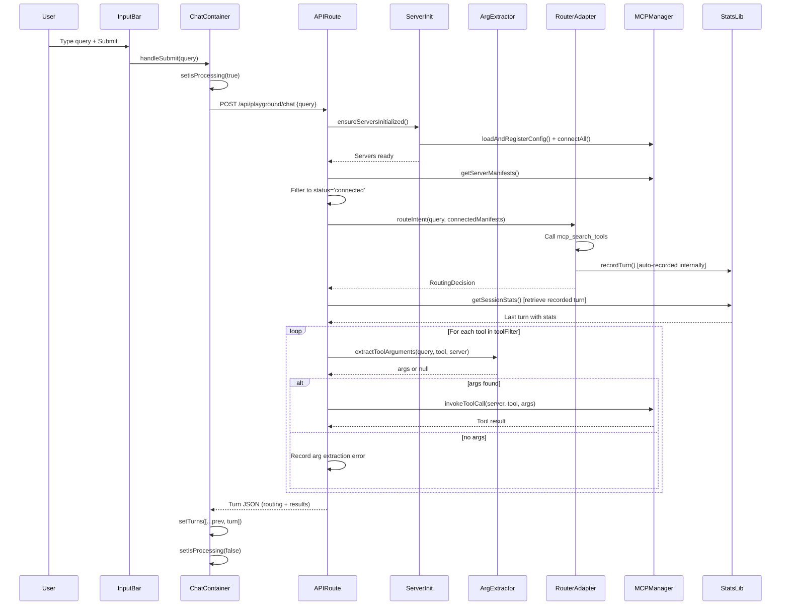

# Playground Chat — Architecture Design

> **Feature**: User-facing chat interface for natural language queries with real-time routing transparency  
> **Status**: Draft (awaiting confirmation)  
> **Author**: Kiro  
> **Date**: 2026-11-06  
> **Requirements**: [requirements.md](./requirements.md)

## Design Overview

The Playground Chat is a Next.js App Router page that provides an interactive chat interface for demonstrating FrankenMCP's routing transparency. It orchestrates the complete query → routing → tool execution → result flow, displaying each step with real-time feedback and recording statistics for the Monster Lab dashboard.

The design prioritizes **immediate feedback** (loading states at each step), **fail-loud error handling** (errors displayed, never hidden), and **seamless integration** with existing router-core and stats infrastructure.

---

## Architecture Diagram

```mermaid
graph TB
    User[User types query] --> PlaygroundPage[Playground Page<br/>src/app/playground/page.tsx]
    PlaygroundPage --> ChatContainer[ChatContainer<br/>Client Component]
    ChatContainer --> InputBar[InputBar<br/>form + submit]
    ChatContainer --> ConversationHistory[ConversationHistory<br/>scrollable list]
    
    InputBar --> SubmitHandler[handleSubmit]
    SubmitHandler --> APIRoute[POST /api/playground/chat<br/>Server-side API Route]
    
    APIRoute --> ServerInit[Server Initialization<br/>lazy singleton]
    ServerInit --> MCPManagerInit[MCPServerManager<br/>loadAndRegisterConfig + connectAll]
    
    APIRoute --> ArgExtractor[extractToolArguments<br/>hardcoded patterns]
    ArgExtractor --> RouterAdapter[routeIntent<br/>src/lib/router/adapter.ts]
    RouterAdapter --> AutoRecord[Auto-records turn<br/>via recordTurn internally]
    AutoRecord --> SessionStats[Session Statistics<br/>in-memory server state]
    
    RouterAdapter --> RoutingDecision[RoutingDecision]
    RoutingDecision --> ToolExecutor[executeTools<br/>server-side]
    ToolExecutor --> MCPManager[MCPServerManager<br/>invokeToolCall]
    MCPManager --> DemoServers[Demo MCP Servers<br/>stdio subprocesses]
    
    ToolExecutor --> APIRoute
    APIRoute --> ChatContainer[Returns Turn JSON]
    
    SessionStats -.->|accessible by| LabDashboard[/lab Dashboard<br/>via getSessionStats]
    
    ConversationHistory --> TurnDisplay[TurnDisplay<br/>per-turn component]
    TurnDisplay --> RoutingInfo[Routing Stats Display]
    TurnDisplay --> ToolResults[Tool Results Display]
    
    style APIRoute fill:#f9f,stroke:#333,stroke-width:2px
    style ServerInit fill:#ff9,stroke:#333
    style AutoRecord fill:#9f9,stroke:#333
    style DemoServers fill:#9f9,stroke:#333
```

---

## Component & Module Hierarchy

```
src/app/playground/
├── page.tsx                    # Main Playground page (Client Component wrapper)
└── components/
    ├── ChatContainer.tsx       # Main chat orchestration (Client Component)
    ├── InputBar.tsx            # Query input + submit (Client Component)
    ├── ConversationHistory.tsx # Scrollable turn list (Client Component)
    ├── TurnDisplay.tsx         # Individual turn display (pure component)
    ├── RoutingStatsCard.tsx    # Routing decision summary (pure component)
    ├── ToolResultCard.tsx      # Tool execution result (pure component)
    ├── LoadingIndicator.tsx    # Loading spinner with message (pure component)
    ├── ErrorMessage.tsx        # Error display (pure component)
    └── WelcomeMessage.tsx      # Empty state with example queries (pure component)

src/app/api/playground/
└── chat/
    └── route.ts                # POST endpoint (server-side only)

src/lib/server/                 # Server-only modules
├── init.ts                     # Lazy server initialization singleton
└── extractToolArguments.ts     # Hardcoded argument extraction patterns
```

---

## Component Design

### 1. Playground Page (`src/app/playground/page.tsx`)

**Purpose**: Entry point for Playground, wraps ChatContainer client component.

**Implementation**:
- Client Component wrapper (conversation state is client-side)
- No server-side data fetching required (all data generated via API route during user interaction)

**Code Skeleton**:
```typescript
// src/app/playground/page.tsx
'use client';

import ChatContainer from './components/ChatContainer';

export default function PlaygroundPage() {
  return (
    <div className="min-h-screen bg-gray-950 text-gray-100">
      <header className="border-b border-purple-900/30 px-8 py-6">
        <h1 className="text-4xl font-bold text-purple-400">
          🎮 Playground
        </h1>
        <p className="text-gray-400 mt-2">
          Ask questions, see routing decisions in real-time
        </p>
      </header>

      <main className="h-[calc(100vh-120px)]">
        <ChatContainer />
      </main>
    </div>
  );
}
```

---

### 2. ChatContainer (`src/app/playground/components/ChatContainer.tsx`)

**Purpose**: Orchestrate query submission via API and display conversation history.

**Implementation**:
- Client Component with state management
- State: `turns: Turn[]` (conversation history), `isProcessing: boolean`, `currentError: string | null`
- Handles: query submission → POST to `/api/playground/chat` → receive completed turn → UI update

**State Type**:
```typescript
interface Turn {
  id: string;
  timestamp: number;
  userQuery: string;
  routing?: {
    selectedServers: string[];
    toolsLoaded: number;
    toolsTrimmed: number;
    estimatedTokensSaved: number;
    routingTimeMs: number;
    reasoning?: string;
  };
  toolResults?: Array<{
    serverID: string;
    toolName: string;
    status: 'success' | 'error';
    result?: any;
    error?: string;
  }>;
  error?: string;
}
```

**Key Functions**:
```typescript
async function handleSubmit(query: string): Promise<void> {
  setIsProcessing(true);
  setCurrentError(null);
  
  try {
    // Call server-side API route that performs routing + tool execution + turn recording
    const response = await fetch('/api/playground/chat', {
      method: 'POST',
      headers: { 'Content-Type': 'application/json' },
      body: JSON.stringify({ query }),
    });
    
    if (!response.ok) {
      const errorData = await response.json();
      throw new Error(errorData.error || 'API request failed');
    }
    
    const turn: Turn = await response.json();
    setTurns((prev) => [...prev, turn]);
    
  } catch (error) {
    // Create error turn for display
    const errorTurn: Turn = {
      id: crypto.randomUUID(),
      timestamp: Date.now(),
      userQuery: query,
      error: error instanceof Error ? error.message : 'Unknown error',
    };
    setTurns((prev) => [...prev, errorTurn]);
    
    // Set global error for RouterUnavailable case
    if (error instanceof Error && error.message.includes('Router unavailable')) {
      setCurrentError(error.message);
    }
  } finally {
    setIsProcessing(false);
  }
}
```

**Error Handling**:
- API errors → create error turn and append to history
- `RouterUnavailableError` → set `currentError` for prominent banner
- Network errors → display in turn, allow retry

---

### 3. API Route (`src/app/api/playground/chat/route.ts`)

**Purpose**: Server-side endpoint that performs routing, tool execution, and turn recording.

**Implementation**:
- Next.js API Route (server-side only)
- Receives: `{ query: string }`
- Returns: `Turn` object with routing stats and tool results
- Handles server initialization lazily via singleton

**Server Initialization**:
```typescript
// src/lib/server/init.ts (server-only module)
import { MCPServerManager } from '@/lib/mcp/server-manager';
import path from 'path';

let initialized = false;

export async function ensureServersInitialized() {
  if (initialized) return;
  
  const manager = MCPServerManager.getInstance();
  const configPath = path.resolve(process.cwd(), '.kiro/settings/mcp.json');
  await manager.loadAndRegisterConfig(configPath);
  await manager.connectAll();
  
  initialized = true;
}
```

**Tool Argument Extraction Patterns**:
```typescript
// src/lib/server/extractToolArguments.ts (server-only)
function extractToolArguments(query: string, toolName: string, serverID: string): Record<string, any> | null {
  const lowerQuery = query.toLowerCase();
  
  // Notes server patterns
  if (serverID === 'notes') {
    if (toolName === 'create_note') {
      // "Add a note about X" or "Create a note X"
      const match = lowerQuery.match(/(?:add|create) a note (?:about |titled )?(.+)/);
      if (match) {
        const content = match[1].trim();
        return { title: content, content: content };
      }
    }
    if (toolName === 'list_notes' || toolName === 'read_note' || toolName === 'delete_note' || toolName === 'update_note') {
      // List/read/delete/update typically need no args or IDs not in query
      if (toolName === 'list_notes') return {};
      // For read/delete/update, would need ID extraction (not demo-ready)
      return null;
    }
  }
  
  // Tasks server patterns
  if (serverID === 'tasks') {
    if (toolName === 'create_task') {
      const match = lowerQuery.match(/(?:add|create) (?:a )?task (.+)/);
      if (match) {
        return { title: match[1].trim(), priority: 'medium' };
      }
    }
    if (toolName === 'list_tasks') return {};
  }
  
  // Calculator server patterns
  if (serverID === 'calculator') {
    // "What is A + B?" or "Calculate A plus B"
    if (toolName === 'add') {
      const match = query.match(/(\d+\.?\d*)\s*\+\s*(\d+\.?\d*)/);
      if (match) return { a: parseFloat(match[1]), b: parseFloat(match[2]) };
    }
    if (toolName === 'subtract') {
      const match = query.match(/(\d+\.?\d*)\s*-\s*(\d+\.?\d*)/);
      if (match) return { a: parseFloat(match[1]), b: parseFloat(match[2]) };
    }
    if (toolName === 'multiply') {
      const match = query.match(/(\d+\.?\d*)\s*[*×]\s*(\d+\.?\d*)/);
      if (match) return { a: parseFloat(match[1]), b: parseFloat(match[2]) };
    }
    if (toolName === 'divide') {
      const match = query.match(/(\d+\.?\d*)\s*[/÷]\s*(\d+\.?\d*)/);
      if (match) return { a: parseFloat(match[1]), b: parseFloat(match[2]) };
    }
  }
  
  // No pattern matched
  return null;
}
```

**Route Handler**:
```typescript
// src/app/api/playground/chat/route.ts
import { NextResponse } from 'next/server';
import { ensureServersInitialized } from '@/lib/server/init';
import { MCPServerManager } from '@/lib/mcp/server-manager';
import { routeIntent } from '@/lib/router/adapter';
import { getSessionStats } from '@/lib/router/stats';
import { extractToolArguments } from '@/lib/server/extractToolArguments';

export async function POST(request: Request) {
  try {
    await ensureServersInitialized();
    
    const { query } = await request.json();
    if (!query || query.trim().length === 0) {
      return NextResponse.json({ error: 'Query required' }, { status: 400 });
    }
    
    const manager = MCPServerManager.getInstance();
    
    // Filter manifests to connected servers only
    const allManifests = manager.getServerManifests();
    const connectedManifests = allManifests.filter(m => m.status === 'connected');
    
    if (connectedManifests.length === 0) {
      return NextResponse.json({
        error: 'All servers offline. Please check server configuration.',
      }, { status: 503 });
    }
    
    // Check for disconnected servers and prepare warnings
    const disconnectedServers = allManifests
      .filter(m => m.status !== 'connected')
      .map(m => m.name);
    
    // Route the intent (auto-records turn internally)
    const routingStartTime = Date.now();
    const decision = await routeIntent(query, connectedManifests);
    const routingEndTime = Date.now();
    
    // Retrieve the auto-recorded turn statistics
    const sessionStats = getSessionStats();
    const recordedTurn = sessionStats.turns[sessionStats.turns.length - 1];
    
    // Execute tools sequentially
    const toolResults = [];
    for (const filter of decision.toolFilter) {
      for (const toolName of filter.includedTools) {
        const args = extractToolArguments(query, toolName, filter.serverID);
        
        if (args === null) {
          // No pattern matched
          toolResults.push({
            serverID: filter.serverID,
            toolName,
            status: 'error',
            error: `Unable to extract arguments for ${toolName}`,
          });
          continue;
        }
        
        try {
          const result = await manager.invokeToolCall(filter.serverID, toolName, args);
          toolResults.push({
            serverID: filter.serverID,
            toolName,
            status: 'success',
            result,
          });
        } catch (error) {
          toolResults.push({
            serverID: filter.serverID,
            toolName,
            status: 'error',
            error: error instanceof Error ? error.message : 'Tool execution failed',
          });
        }
      }
    }
    
    // Build Turn response
    const turn = {
      id: recordedTurn.turnID,
      timestamp: recordedTurn.timestamp,
      userQuery: query,
      routing: {
        selectedServers: decision.selectedServers,
        toolsLoaded: recordedTurn.toolsLoaded,
        toolsTrimmed: recordedTurn.toolsTrimmed,
        estimatedTokensSaved: recordedTurn.estimatedTokensSaved,
        routingTimeMs: recordedTurn.routingTimeMs,
        reasoning: decision.reasoning,
      },
      toolResults,
      warnings: disconnectedServers.length > 0
        ? disconnectedServers.map(name => `Server '${name}' unavailable`)
        : undefined,
    };
    
    return NextResponse.json(turn);
    
  } catch (error) {
    console.error('Playground API error:', error);
    return NextResponse.json(
      { error: error instanceof Error ? error.message : 'Internal server error' },
      { status: 500 }
    );
  }
}
```

**Data Source**: 
- Server-side `routeIntent()` (auto-records turn)
- Server-side `MCPServerManager` (tool execution)
- Server-side `getSessionStats()` (retrieve recorded turn)

---

### 4. InputBar (`src/app/playground/components/InputBar.tsx`)

**Purpose**: Text input field with submit button and validation.

**Implementation**:
- Client Component (form handling)
- Controlled input with local state
- Disabled during processing
- Enter key submits, Shift+Enter adds newline

**Code Skeleton**:
```typescript
// src/app/playground/components/InputBar.tsx
'use client';

import { useState, FormEvent } from 'react';

interface InputBarProps {
  onSubmit: (query: string) => Promise<void>;
  disabled: boolean;
}

export default function InputBar({ onSubmit, disabled }: InputBarProps) {
  const [query, setQuery] = useState('');
  const [validationError, setValidationError] = useState<string | null>(null);

  async function handleSubmit(e: FormEvent) {
    e.preventDefault();
    const trimmed = query.trim();
    
    if (trimmed.length === 0) {
      setValidationError('Please enter a query');
      return;
    }
    
    if (trimmed.length > 1000) {
      setValidationError('Query too long (max 1000 characters)');
      return;
    }
    
    setValidationError(null);
    await onSubmit(trimmed);
    setQuery('');
  }

  return (
    <div className="border-t border-purple-900/30 p-4 bg-gray-900">
      <form onSubmit={handleSubmit} className="flex gap-2">
        <input
          type="text"
          value={query}
          onChange={(e) => setQuery(e.target.value)}
          placeholder="Ask a question..."
          disabled={disabled}
          className="flex-1 bg-gray-800 border border-gray-700 rounded px-4 py-2 text-gray-100 placeholder-gray-500 focus:outline-none focus:border-purple-500 disabled:opacity-50"
        />
        <button
          type="submit"
          disabled={disabled || query.trim().length === 0}
          className="px-6 py-2 bg-purple-600 text-white rounded hover:bg-purple-700 disabled:opacity-50 disabled:cursor-not-allowed"
        >
          {disabled ? 'Processing...' : 'Submit'}
        </button>
      </form>
      {validationError && (
        <div className="mt-2 text-sm text-red-400">{validationError}</div>
      )}
    </div>
  );
}
```

---

### 5. ConversationHistory (`src/app/playground/components/ConversationHistory.tsx`)

**Purpose**: Scrollable list of all turns in the conversation.

**Implementation**:
- Client Component (auto-scroll to latest turn)
- Renders `<TurnDisplay>` for each turn
- Empty state: renders `<WelcomeMessage>`

**Code Skeleton**:
```typescript
// src/app/playground/components/ConversationHistory.tsx
'use client';

import { useEffect, useRef } from 'react';
import TurnDisplay from './TurnDisplay';
import WelcomeMessage from './WelcomeMessage';

interface ConversationHistoryProps {
  turns: Turn[];
  onExampleClick: (query: string) => void;
}

export default function ConversationHistory({ turns, onExampleClick }: ConversationHistoryProps) {
  const bottomRef = useRef<HTMLDivElement>(null);

  useEffect(() => {
    // Auto-scroll to bottom when new turn added
    bottomRef.current?.scrollIntoView({ behavior: 'smooth' });
  }, [turns.length]);

  if (turns.length === 0) {
    return <WelcomeMessage onExampleClick={onExampleClick} />;
  }

  return (
    <div className="flex-1 overflow-y-auto p-8 space-y-6">
      {turns.map((turn) => (
        <TurnDisplay key={turn.id} turn={turn} />
      ))}
      <div ref={bottomRef} />
    </div>
  );
}
```

---

### 6. TurnDisplay (`src/app/playground/components/TurnDisplay.tsx`)

**Purpose**: Display a single conversation turn (query + routing + results).

**Implementation**:
- Pure component (no state)
- Visual sections: user query, routing stats, tool results, errors

**Visual Layout**:
```
┌──────────────────────────────────────────────────────────────┐
│  🙋 User: "Add a note about the meeting"                     │
│  ⏰ 14:32:15                                                  │
├──────────────────────────────────────────────────────────────┤
│  📊 Routing Decision                                          │
│  Servers: notes                                               │
│  Loaded: 1 tool  │  Trimmed: 4 tools  │  Saved: ~120 tokens │
│  Reasoning: "Query mentions 'note' and 'add'..."             │
├──────────────────────────────────────────────────────────────┤
│  🔧 Tool Results                                              │
│  ✓ notes.create_note                                         │
│  { "id": "abc123", "title": "Meeting notes" }                │
└──────────────────────────────────────────────────────────────┘
```

**Code Skeleton**:
```typescript
// src/app/playground/components/TurnDisplay.tsx
import RoutingStatsCard from './RoutingStatsCard';
import ToolResultCard from './ToolResultCard';
import ErrorMessage from './ErrorMessage';

interface TurnDisplayProps {
  turn: Turn;
}

export default function TurnDisplay({ turn }: TurnDisplayProps) {
  const timestamp = new Date(turn.timestamp).toLocaleTimeString();

  return (
    <div className="border border-purple-900/30 rounded-lg bg-gray-900 p-6 space-y-4">
      {/* User Query */}
      <div>
        <div className="flex items-center gap-2 mb-2">
          <span className="text-2xl">🙋</span>
          <span className="text-sm text-gray-500">{timestamp}</span>
        </div>
        <div className="text-lg text-gray-100">{turn.userQuery}</div>
      </div>

      {/* Routing Stats */}
      {turn.routing && (
        <RoutingStatsCard routing={turn.routing} />
      )}

      {/* Tool Results */}
      {turn.toolResults && turn.toolResults.length > 0 && (
        <div>
          <h3 className="text-sm font-bold text-purple-400 mb-2">🔧 Tool Results</h3>
          <div className="space-y-2">
            {turn.toolResults.map((result, idx) => (
              <ToolResultCard key={idx} result={result} />
            ))}
          </div>
        </div>
      )}

      {/* Error */}
      {turn.error && <ErrorMessage message={turn.error} />}
    </div>
  );
}
```

---

### 7. RoutingStatsCard (`src/app/playground/components/RoutingStatsCard.tsx`)

**Purpose**: Display routing decision summary with metrics.

**Implementation**:
- Pure component
- Color-coded metrics (green for loaded, purple for trimmed, cyan for saved)

**Code Skeleton**:
```typescript
// src/app/playground/components/RoutingStatsCard.tsx
interface RoutingStatsCardProps {
  routing: {
    selectedServers: string[];
    toolsLoaded: number;
    toolsTrimmed: number;
    estimatedTokensSaved: number;
    reasoning?: string;
  };
}

export default function RoutingStatsCard({ routing }: RoutingStatsCardProps) {
  return (
    <div className="bg-gray-800 border border-purple-700/50 rounded p-4 space-y-2">
      <h3 className="text-sm font-bold text-purple-400">📊 Routing Decision</h3>
      
      <div className="flex items-center gap-2 text-sm">
        <span className="text-gray-400">Servers:</span>
        <span className="font-mono text-purple-300">
          {routing.selectedServers.join(', ')}
        </span>
      </div>

      <div className="flex gap-6 text-sm">
        <div>
          <span className="text-gray-400">Loaded:</span>
          <span className="ml-2 text-green-400 font-bold">{routing.toolsLoaded} tools</span>
        </div>
        <div>
          <span className="text-gray-400">Trimmed:</span>
          <span className="ml-2 text-purple-400 font-bold">{routing.toolsTrimmed} tools</span>
        </div>
        <div>
          <span className="text-gray-400">Saved:</span>
          <span className="ml-2 text-cyan-400 font-bold">~{routing.estimatedTokensSaved} tokens</span>
        </div>
      </div>

      {routing.reasoning && (
        <div className="text-xs text-gray-400 italic mt-2">
          {routing.reasoning}
        </div>
      )}
    </div>
  );
}
```

---

### 8. ToolResultCard (`src/app/playground/components/ToolResultCard.tsx`)

**Purpose**: Display individual tool execution result or error.

**Implementation**:
- Pure component
- Collapsible for long results (>500 chars)
- JSON pretty-printing for object results

**Code Skeleton**:
```typescript
// src/app/playground/components/ToolResultCard.tsx
'use client';

import { useState } from 'react';

interface ToolResultCardProps {
  result: {
    serverID: string;
    toolName: string;
    status: 'success' | 'error';
    result?: any;
    error?: string;
  };
}

export default function ToolResultCard({ result }: ToolResultCardProps) {
  const [expanded, setExpanded] = useState(false);
  const resultString = JSON.stringify(result.result, null, 2);
  const isLong = resultString.length > 500;

  return (
    <div className={`border rounded p-3 ${
      result.status === 'success' 
        ? 'border-green-700/50 bg-green-900/10' 
        : 'border-red-700/50 bg-red-900/10'
    }`}>
      <div className="flex items-center gap-2 mb-2">
        <span>{result.status === 'success' ? '✓' : '✗'}</span>
        <span className="font-mono text-sm">
          {result.serverID}.{result.toolName}
        </span>
      </div>

      {result.status === 'success' ? (
        <div>
          <pre className={`text-xs overflow-x-auto ${isLong && !expanded ? 'max-h-32 overflow-y-hidden' : ''}`}>
            <code className="text-gray-300">{resultString}</code>
          </pre>
          {isLong && (
            <button
              onClick={() => setExpanded(!expanded)}
              className="text-xs text-purple-400 hover:text-purple-300 mt-2"
            >
              {expanded ? 'Show less' : 'Show more'}
            </button>
          )}
        </div>
      ) : (
        <div className="text-sm text-red-300">{result.error}</div>
      )}
    </div>
  );
}
```

---

### 9. WelcomeMessage (`src/app/playground/components/WelcomeMessage.tsx`)

**Purpose**: Empty state with example queries to guide first-time users.

**Implementation**:
- Pure component
- Clickable example queries populate input field

**Code Skeleton**:
```typescript
// src/app/playground/components/WelcomeMessage.tsx
interface WelcomeMessageProps {
  onExampleClick: (query: string) => void;
}

const EXAMPLE_QUERIES = [
  { text: 'Add a note about the meeting', server: 'notes' },
  { text: 'Show my tasks', server: 'tasks' },
  { text: 'What is 42 + 58?', server: 'calculator' },
];

export default function WelcomeMessage({ onExampleClick }: WelcomeMessageProps) {
  return (
    <div className="flex-1 flex items-center justify-center p-8">
      <div className="max-w-2xl text-center space-y-6">
        <div className="text-6xl mb-4">🎮</div>
        <h2 className="text-3xl font-bold text-purple-400">
          Welcome to FrankenMCP Playground
        </h2>
        <p className="text-gray-400 text-lg">
          Ask questions and watch the router select relevant tools in real-time,
          trimming unnecessary context to save tokens.
        </p>

        <div className="mt-8">
          <h3 className="text-sm font-bold text-gray-500 mb-3">TRY THESE EXAMPLES:</h3>
          <div className="space-y-2">
            {EXAMPLE_QUERIES.map((example, idx) => (
              <button
                key={idx}
                onClick={() => onExampleClick(example.text)}
                className="w-full text-left px-4 py-3 bg-gray-800 border border-gray-700 rounded hover:border-purple-500 hover:bg-gray-750 transition"
              >
                <div className="text-gray-100">{example.text}</div>
                <div className="text-xs text-gray-500 mt-1">
                  → Routes to <span className="text-purple-400">{example.server}</span> server
                </div>
              </button>
            ))}
          </div>
        </div>
      </div>
    </div>
  );
}
```

---

## Data Flow

### Query Submission Flow



---

## Error Handling Strategy

### Routing Errors

**Scenario**: `routeIntent()` throws `NoRelevantToolsError`

**Response**:
1. Set `turn.error = "No relevant tools found for this query"`
2. Do NOT proceed to tool execution
3. Append turn to history with error displayed
4. Re-enable input for next query

**Scenario**: `routeIntent()` throws `RoutingTimeoutError`

**Response**:
1. Set `turn.error = "Routing timed out. Please try again."`
2. Do NOT proceed to tool execution
3. Allow user to retry same query

**Scenario**: `routeIntent()` throws `RouterUnavailableError`

**Response**:
1. Set `turn.error = "Router unavailable. Please restart the application."`
2. Display prominent error banner at top of page
3. Disable input field until page refresh

### Tool Execution Errors

**Scenario**: `invokeToolCall()` throws `ToolInvocationError`

**Response**:
1. Record error in `turn.toolResults[].error`
2. Do NOT crash or skip remaining tools
3. Display error inline with tool name
4. Continue executing remaining tools sequentially

**Scenario**: Tool execution timeout (>10s)

**Response**:
1. Abort tool call with timeout error
2. Record in `turn.toolResults[].error = "Tool execution timed out"`
3. Allow retry of entire query

### Server Disconnection

**Scenario**: Server disconnects mid-session

**Response**:
1. API route filters manifests to `status === 'connected'` before calling `routeIntent()`
2. Disconnected servers excluded from routing pool
3. API route returns warnings array: `["Server 'notes' unavailable"]`
4. UI displays warnings prominently in turn display
5. Proceed with remaining connected servers

---

## Integration with Monster Lab Dashboard

### Turn Recording

The Playground does NOT call `recordTurn()` itself. `routeIntent()` already records the turn automatically (adapter.ts Task 4.1 wiring: `calculateTurnStats` + `recordTurn` before returning the decision). The API route retrieves the auto-recorded turn via `getSessionStats()` immediately after `routeIntent()` returns and uses its statistics for the response — calling `recordTurn()` a second time would record every query twice (3 queries would show 6 turns in `/lab`).

**Verification**:

- User submits 3 queries in Playground

- User navigates to `/lab`

- Dashboard displays exactly 3 turns with matching statistics (not 6)

---

## Styling & Theme

### Color Palette

**Page Background**: `bg-gray-950` (consistent with Monster Lab)

**Primary Accent** (purple for Playground):
- Headings: `text-purple-400`
- Borders: `border-purple-900/30`
- Buttons: `bg-purple-600 hover:bg-purple-700`

**Metric Colors** (consistent with dashboard):
- Tools loaded: `text-green-400`
- Tools trimmed: `text-purple-400`
- Tokens saved: `text-cyan-400`

**Status Colors**:
- Success: `border-green-700/50 bg-green-900/10`
- Error: `border-red-700/50 bg-red-900/10`

### Typography

- Page title: `text-4xl font-bold`
- Turn timestamp: `text-sm text-gray-500`
- User query: `text-lg text-gray-100`
- Metric labels: `text-sm text-gray-400`
- Tool names: `font-mono text-sm`

### Responsive Breakpoints

- Mobile (<768px): Full-width input, stacked turn sections
- Tablet/Desktop (≥768px): Same layout (chat is inherently vertical)

---

## Performance Considerations

### Conversation History Scalability

**Concern**: Large conversation history slows down rendering

**Mitigation**:
- Use React `key` prop for efficient re-renders
- Auto-scroll only on new turn (not on every render)
- Future: Virtualize conversation history if >100 turns

### Tool Execution Timeout

**Default**: 10 second timeout per tool call

**Implementation**:
```typescript
const toolPromise = manager.invokeToolCall(serverID, toolName, args);
const timeoutPromise = new Promise((_, reject) =>
  setTimeout(() => reject(new Error('Tool execution timed out')), 10000)
);
const result = await Promise.race([toolPromise, timeoutPromise]);
```

### Sequential Tool Execution

**Decision**: **Sequential** (matches FR-3.7, resolved Open Question 2)

**Rationale**:
- Simpler to implement and debug
- Most queries select 1-2 tools (low parallelization benefit)
- Results display in **submission order** (FR-3.7)
- Errors in one tool do not prevent subsequent tools from executing
- Future enhancement: Parallel execution with `Promise.allSettled()` if performance demands it

---

## Testing Strategy

### Component Tests

**InputBar**:
- Submit with valid query → verify `onSubmit` called with trimmed query
- Submit with empty query → verify validation error shown
- Submit with >1000 chars → verify validation error shown
- Disabled state → verify input and button disabled

**ConversationHistory**:
- Empty turns array → verify `<WelcomeMessage>` shown
- Non-empty turns → verify each turn rendered via `<TurnDisplay>`
- Auto-scroll → verify scroll position updates on new turn

**TurnDisplay**:
- Turn with routing only → verify routing stats displayed, no tool results
- Turn with tool results → verify results displayed with correct status
- Turn with error → verify error message displayed

**ToolResultCard**:
- Success result → verify green border, result JSON displayed
- Error result → verify red border, error message displayed
- Long result (>500 chars) → verify "Show more" button, collapsible

**WelcomeMessage**:
- Click example query → verify `onExampleClick` called with query text

### Integration Tests

**Full Query Flow**:
- Submit "Add a note" → verify routing stats displayed → tool result displayed → turn added to history
- Submit 3 queries → verify 3 turns in history
- Submit query with no relevant tools → verify error displayed, no tool execution

**Dashboard Integration**:
- Submit 2 queries in Playground
- Call `getSessionStats()`
- Verify 2 turns in stats with matching intent, servers, tool counts

**Error Scenarios**:
- Mock `routeIntent()` to throw `NoRelevantToolsError` → verify error displayed, input re-enabled
- Mock `invokeToolCall()` to throw error → verify error in tool result, turn still recorded
- Mock all servers offline → verify routing fails, prominent error shown

---

## Open Design Decisions

### 1. Conversation History Persistence

**Question**: Should conversation history persist across page refreshes?

**Options**:
- **A**: Session-scoped (lost on refresh) — current design
- **B**: LocalStorage (persists per-browser)
- **C**: Database (persists globally)

**Recommendation**: Start with A (session-scoped), add B if users request persistence

### 2. Tool Argument Extraction ✅ Decided

**Decision**: **A — Hardcoded regex patterns** for demo tool arguments

**Implementation**: See API Route section for complete pattern definitions:
- **Notes**: `create_note` extracts from "Add a note about X"
- **Tasks**: `create_task` extracts from "Add/create task X"
- **Calculator**: `add/subtract/multiply/divide` extract from "A + B" format
- **List operations**: Accept empty args `{}`
- **No match**: Return error, do not execute tool

**Out of scope**: LLM-based extraction (violates C-6 zero-config)

### 3. Auto-Scroll Behavior

**Question**: Should Playground auto-scroll to latest turn?

**Options**:
- **A**: Always auto-scroll (current design)
- **B**: Auto-scroll only if user is near bottom
- **C**: Manual scroll control, no auto-scroll

**Recommendation**: Start with A, add B if users report scroll hijacking issues

---

## Deployment Considerations

### Vercel Constraints

**Risk**: Same multi-instance issue as Monster Lab Dashboard

**Mitigation**:
- Playground state (turns) is client-side, not affected by multi-instance
- Turn recording calls server-side `recordTurn()`, subject to instance mismatch
- Same assumption: single-instance demo deployment

### Environment Variables

None required (demo servers only, no external APIs)

---

## Future Enhancements (Out of Scope)

1. **Multi-Turn Conversations**: Context from previous turns informs next query
2. **LLM Integration**: Automatic argument extraction from natural language
3. **Export Chat**: Download conversation as JSON or Markdown
4. **Syntax Highlighting**: Better formatting for code results
5. **Voice Input**: Speech-to-text query submission

---

## Traceability Matrix

| Requirement | Design Component | Data Source |
|-------------|------------------|-------------|
| FR-1.1 to FR-1.5 | `InputBar` | User input, form validation |
| FR-2.1 to FR-2.8 | `POST /api/playground/chat`, `ChatContainer` (fetch), `RoutingStatsCard` | `routeIntent()` output |
| FR-3.1 to FR-3.8 | API route `extractToolArguments` + `executeTools`, `ToolResultCard` | Server-side `MCPServerManager.invokeToolCall()` |
| FR-4.1 to FR-4.5 | `ConversationHistory`, `TurnDisplay` | Client state `turns[]` |
| FR-5.1 to FR-5.4 | API route → `routeIntent()` auto-records | `src/lib/router/stats.ts` |
| FR-6.1 to FR-6.5 | Zero config, demo server check | `MCPServerManager.getServerManifests()` |
| FR-7.1 to FR-7.4 | `WelcomeMessage` | Hardcoded example queries |
| NFR-1.1 to NFR-1.3 | Performance optimizations | React rendering, key props |
| NFR-2.1 to NFR-2.3 | Error handling in `ChatContainer` | Try/catch + error state |
| NFR-3.1 to NFR-3.3 | Responsive layout, collapsible results | Tailwind breakpoints |
| NFR-4.1 to NFR-4.3 | Integration tests | Real `routeIntent`, `recordTurn`, `getSessionStats` |

---

## Changes from Previous Versions

_Initial version._
