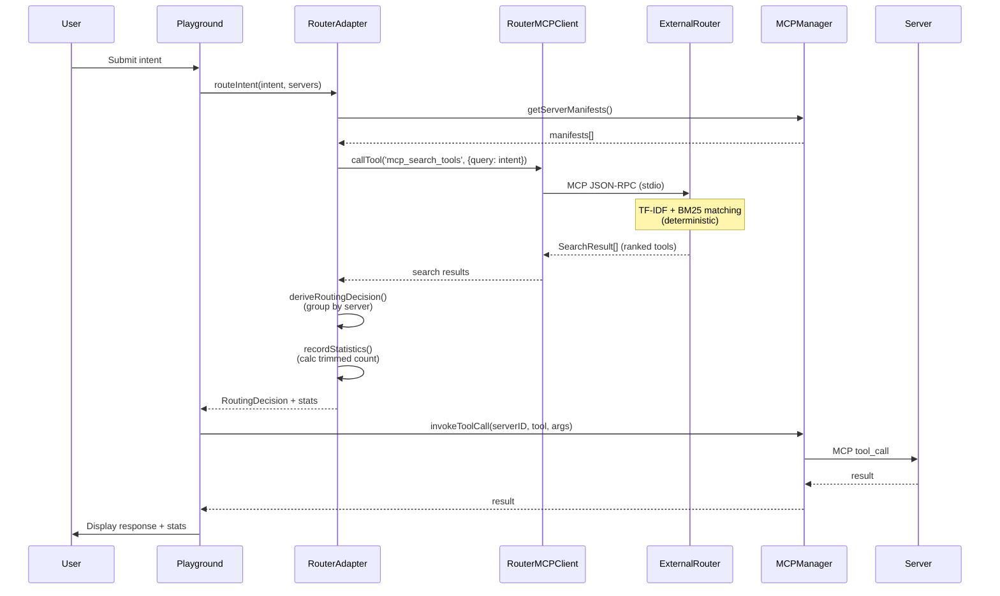

# Router Core — Architecture Design

> **Feature**: Dynamic MCP router with schema trimming and per-turn statistics  
> **Status**: Draft (awaiting confirmation)  
> **Author**: Kiro  
> **Date**: 2026-11-05  
> **Requirements**: [requirements.md](./requirements.md)

## Design Overview

The router core orchestrates multiple MCP servers through a three-layer architecture:

1. **Adapter Layer** (`src/lib/router/`) — wraps the external `mcp-dynamic-router` dependency
2. **MCP Manager Layer** (`src/lib/mcp/`) — handles server lifecycle and tool invocation
3. **Demo Server Layer** (`src/mcp-servers/`) — provides zero-config demonstration servers

The design prioritizes **fail-loud behavior** (no silent mock fallbacks), **real-time statistics tracking** (no hard-coded numbers), and **physical isolation** between production and demo code.

---

## Architecture Diagram

```mermaid
graph TB
    User[User Intent] --> Playground[Playground UI]
    Playground --> RouterAdapter[Router Adapter]
    RouterAdapter --> ExternalRouter[mcp-dynamic-router<br/>external dependency]
    ExternalRouter --> RouterAdapter
    RouterAdapter --> MCPManager[MCP Server Manager]
    MCPManager --> NotesServer[Notes Server<br/>stdio]
    MCPManager --> TasksServer[Tasks Server<br/>stdio]
    MCPManager --> CalcServer[Calculator Server<br/>stdio]
    MCPManager --> OptionalServer[Optional Servers<br/>SSE/HTTP]
    
    RouterAdapter --> Stats[Statistics Tracker]
    Stats --> Dashboard[Monster Lab Dashboard]
    
    MCPManager -.->|health checks| ServerHealth[Server Health Monitor]
    ServerHealth --> Dashboard
    
    Demo[Demo Fixtures] -.->|labeled [DEMO]| NotesServer
    Demo -.->|labeled [DEMO]| TasksServer
    
    style ExternalRouter fill:#f9f,stroke:#333,stroke-width:2px
    style Demo fill:#ff9,stroke:#333,stroke-dasharray: 5 5
```

---

## Component Design

### 1. Router Adapter Layer (`src/lib/router/`)

**Purpose**: Interface between FrankenMCP and the external `mcp-dynamic-router` dependency.

#### 1.1 `adapter.ts` — Router Invocation

**Responsibilities**:
- Spawn the router as a stdio MCP server via `npx -y github:leethoneid/mcp-dynamic-router serve`
- Connect to router using MCP client protocol
- Call `mcp_search_tools` with user intent as query parameter
- Derive `RoutingDecision` from search results (selected servers, relevant tools)
- Handle router errors and timeouts

**Integration Mechanism**:

The `mcp-dynamic-router` exposes two MCP tools via stdio:
1. `mcp_search_tools(query: string)` — returns ranked tools matching query (TF-IDF + BM25)
2. `mcp_call_tool(server: string, tool: string, args: object)` — optional proxy for tool invocation

The adapter uses `mcp_search_tools` to determine routing. The router internally uses **TF-IDF + BM25 keyword matching** (deterministic algorithm from `matcher.ts` in router source), which guarantees routing determinism (PBT invariant 2).

**Key Functions**:

```typescript
interface RoutingDecision {
  selectedServers: string[];        // IDs of servers to use (derived from search results)
  toolFilter: {
    serverID: string;
    includedTools: string[];        // Tools relevant to intent
  }[];
  reasoning?: string;                // Optional explanation (based on search scores)
}

interface SearchResult {
  tool: string;
  server: string;
  score: number;
  description: string;
}

async function routeIntent(
  intent: string,
  availableServers: ServerManifest[]
): Promise<RoutingDecision>

async function startRouterProcess(): Promise<ChildProcess>

async function searchTools(query: string): Promise<SearchResult[]>

function deriveRoutingDecision(
  searchResults: SearchResult[],
  allServers: ServerManifest[]
): RoutingDecision
```

**Derivation Logic**:
1. Call `mcp_search_tools(query=userIntent)` via MCP client
2. Router returns ranked list of relevant tools with scores
3. Group results by `server` field → `selectedServers`
4. For each server, collect `tool` names → `includedTools`
5. Calculate `toolsTrimmed = (tools in selected servers) - includedTools.length`
   - Example: notes server selected (5 tools), router returns 2 → toolsTrimmed = 3

**Error Handling**:
- Router process spawn failure → throw `RouterUnavailableError`
- Router timeout (>2s) → throw `RoutingTimeoutError`
- Invalid router response (malformed JSON-RPC) → throw `InvalidRoutingDecisionError`
- Empty search results → throw `NoRelevantToolsError`
- Never silently fall back to "all servers" or mock decisions

#### 1.2 `stats.ts` — Statistics Tracking

**Responsibilities**:
- Calculate tools loaded vs. tools trimmed per routing decision
- Estimate token savings based on character count of trimmed schemas
- Store per-turn statistics in memory
- Aggregate session-wide metrics

**Data Structure**:

```typescript
interface TurnStatistics {
  turnID: string;
  timestamp: number;
  intent: string;
  selectedServers: string[];
  toolsLoaded: number;              // Tools loaded into context (included by router)
  toolsTrimmed: number;             // Tools excluded from selected servers (NOT from all servers)
  estimatedTokensSaved: number;     // Based on char count / 4 of trimmed tools
  routingTimeMs: number;
}

interface SessionStatistics {
  turns: TurnStatistics[];
  totalToolsLoaded: number;
  totalToolsTrimmed: number;
  totalTokensSaved: number;
  averageRoutingTimeMs: number;
}
```

**Key Functions**:

```typescript
function recordTurn(stats: TurnStatistics): void
function getSessionStats(): SessionStatistics
function estimateTokenSavings(trimmedSchemas: ToolSchema[]): number
```

**Token Estimation Formula**:
```
estimatedTokens = Math.ceil(characterCount / 4)
```
(Standard approximation: 1 token ≈ 4 characters for English text)

#### 1.3 `types.ts` — Type Definitions

**Responsibilities**:
- Define TypeScript interfaces shared across router components
- Ensure type safety between adapter and external router

**Key Types**:

```typescript
interface ServerManifest {
  id: string;
  name: string;
  transport: 'stdio' | 'sse' | 'http';
  tools: ToolSchema[];
  status: 'connected' | 'disconnected' | 'error';
}

interface ToolSchema {
  name: string;
  description: string;
  inputSchema: JSONSchema;
  outputSchema?: JSONSchema;
}

interface JSONSchema {
  type: string;
  properties?: Record<string, any>;
  required?: string[];
  [key: string]: any;
}
```

---

### 2. MCP Manager Layer (`src/lib/mcp/`)

**Purpose**: Manage MCP server lifecycle and tool invocation.

#### 2.1 `server-manager.ts` — Multi-Server Orchestration

**Responsibilities**:
- Load server configurations from `.kiro/settings/mcp.json`
- Spawn stdio servers as child processes
- Connect to SSE/HTTP servers
- Maintain server health status
- Dispatch tool calls to appropriate servers

**Key Functions**:

```typescript
class MCPServerManager {
  async registerServer(config: ServerConfig): Promise<void>
  async unregisterServer(serverID: string): Promise<void>
  async connectAll(): Promise<void>
  async invokeToolCall(
    serverID: string,
    toolName: string,
    args: Record<string, any>
  ): Promise<any>
  getServerStatus(serverID: string): ServerStatus
  getServerManifests(): ServerManifest[]
}

interface ServerConfig {
  id: string;
  name: string;
  transport: 'stdio' | 'sse' | 'http';
  command?: string;           // For stdio
  args?: string[];            // For stdio
  endpoint?: string;          // For SSE/HTTP
  headers?: Record<string, string>;  // For HTTP
}

type ServerStatus = 'connected' | 'disconnected' | 'error' | 'starting';
```

**Lifecycle Management**:
1. **Startup**: Read `.kiro/settings/mcp.json` and spawn all servers
2. **Health Checks**: Ping each server every 30s to verify availability
3. **Reconnection**: Retry failed connections up to 3 times with exponential backoff
4. **Shutdown**: Gracefully terminate all child processes on application exit

**Error Handling**:
- Server spawn failure → mark as `error`, log to console, do NOT use mock
- Tool invocation failure → propagate error to caller with server ID and tool name
- Transport errors → mark server as `disconnected`, exclude from routing

#### 2.2 `client.ts` — MCP Client Wrapper

**Responsibilities**:
- Wrap `@modelcontextprotocol/sdk` client for each server
- Handle protocol-level communication (list tools, invoke tool, handle notifications)
- Parse and validate MCP responses

**Key Functions**:

```typescript
class MCPClient {
  constructor(config: ServerConfig)
  async connect(): Promise<void>
  async listTools(): Promise<ToolSchema[]>
  async callTool(name: string, args: Record<string, any>): Promise<any>
  async disconnect(): Promise<void>
  onNotification(handler: (notification: any) => void): void
}
```

**Protocol Compliance**:
- Implement MCP handshake and capability negotiation
- Support all three transport types (stdio, SSE, HTTP)
- Handle server-initiated notifications (e.g., tool schema updates)

---

### 3. Demo Server Layer (`src/mcp-servers/`)

**Purpose**: Provide zero-config MCP servers for demonstration.

#### 3.1 Notes Server (`notes/`)

**Tools**:
- `create_note(title: string, content: string)` → `{ id: string }`
- `read_note(id: string)` → `{ id: string, title: string, content: string, created: number }`
- `update_note(id: string, title?: string, content?: string)` → `{ id: string }`
- `delete_note(id: string)` → `{ success: boolean }`
- `list_notes()` → `{ notes: Array<{ id: string, title: string }> }`

**Storage**: In-memory Map, optionally persist to `notes.json` in temp directory

**Fixtures**: 3 pre-populated demo notes labeled with `[DEMO]` in content

#### 3.2 Tasks Server (`tasks/`)

**Tools**:
- `create_task(title: string, priority?: 'low'|'medium'|'high')` → `{ id: string }`
- `read_task(id: string)` → `{ id: string, title: string, priority: string, completed: boolean }`
- `update_task(id: string, title?: string, priority?: string, completed?: boolean)` → `{ id: string }`
- `delete_task(id: string)` → `{ success: boolean }`
- `list_tasks(filter?: { completed?: boolean })` → `{ tasks: Array<...> }`

**Storage**: In-memory Map, optionally persist to `tasks.json`

**Fixtures**: 5 pre-populated demo tasks (mix of completed/incomplete)

#### 3.3 Calculator Server (`calculator/`)

**Tools**:
- `add(a: number, b: number)` → `{ result: number }`
- `subtract(a: number, b: number)` → `{ result: number }`
- `multiply(a: number, b: number)` → `{ result: number }`
- `divide(a: number, b: number)` → `{ result: number }` (error if b=0)
- `convert_units(value: number, from: string, to: string)` → `{ result: number }`
  - Supported: length (m, ft, in), weight (kg, lb), temperature (C, F)

**Storage**: None (stateless)

**Implementation**: Each server is an independent Node.js script implementing MCP stdio protocol

---

## Data Flow

### Routing Flow (per user intent)



### Schema Trimming Logic

The external `mcp-dynamic-router` performs tool search using **TF-IDF + BM25 keyword matching** (from `matcher.ts` in router source). This is a deterministic algorithm: same query + same tool corpus → same ranked results.

Our adapter derives routing decisions from search results:

1. **MCPManager provides full tool schemas** from all connected servers
2. **Adapter calls `mcp_search_tools(query=userIntent)`** via MCP client
3. **Router returns ranked list** of relevant tools (each with `{tool, server, score}`)
4. **Adapter derives `RoutingDecision`**:
   - Group results by `server` → `selectedServers`
   - Collect `tool` names per server → `includedTools`
5. **Adapter calculates statistics**:
   - `toolsTrimmed = (total tools in selected servers) - sum(includedTools.length)`
   - Formula: sum each selected server's tool count, subtract loaded tools count
   - `estimatedTokensSaved = sum(char_count(trimmed_schemas)) / 4`

**Example**:
- Notes server has 5 tools (create, read, update, delete, list)
- User asks: "Show me my notes"
- Router search returns: `[{tool: 'read_note', server: 'notes', score: 0.9}, {tool: 'list_notes', server: 'notes', score: 0.8}]`
- Adapter derives: `selectedServers = ['notes']`, `includedTools = ['read_note', 'list_notes']`
- Statistics calculation:
  - `toolsLoaded = 2` (read_note, list_notes)
  - `toolsTrimmed = 3` (create, update, delete — from the selected notes server)
  - `tokensSaved ≈ 300` (character count of 3 trimmed tool schemas / 4)
- Note: `toolsTrimmed` is calculated within selected servers only, not against all 15 tools across all servers

---

## Configuration

### `.kiro/settings/mcp.json` — Server Pre-Configuration

```json
{
  "mcpServers": {
    "notes": {
      "command": "node",
      "args": ["src/mcp-servers/notes/index.mjs"],
      "disabled": false
    },
    "tasks": {
      "command": "node",
      "args": ["src/mcp-servers/tasks/index.mjs"],
      "disabled": false
    },
    "calculator": {
      "command": "node",
      "args": ["src/mcp-servers/calculator/index.mjs"],
      "disabled": false
    }
  }
}
```

**Demo Server Implementation Strategy**:

Demo servers are written as **native ES modules (`.mjs`)** to avoid build steps:
- Source files: `src/mcp-servers/*/index.mjs` (pure JavaScript, no TypeScript)
- No compilation required; Node.js executes them directly
- Use ES module syntax (`import`/`export`) for MCP SDK
- Alternative considered: TypeScript + `tsx` runtime (rejected for simplicity)

**Loading Process**:
1. Application reads config at startup (fails with `MCPConfigParseError` if malformed)
2. MCPServerManager spawns each enabled server as child process
3. Waits for MCP handshake completion (max 5s timeout per server)
4. Queries tool list from each server via `list_tools`
5. Marks servers as `connected` or `error`
6. If all servers fail, throws `AllServersUnavailableError`

---

## Schema Trimming Strategy

### Required Parameter Preservation (PBT Invariant 1)

**Rule**: If a tool is included in the routing decision, ALL required parameters MUST remain in the schema when passed to the LLM or invoked.

**Implementation**:
- Adapter derives `includedTools` from router search results
- When loading schemas for included tools, adapter fetches original schemas from MCPManager
- Adapter validates that all `inputSchema.required[]` fields are present
- No schema mutation occurs; "trimming" means excluding entire tool schemas, not removing fields

**PBT Test** (validates FR-2.3, NFR-3.2):
```typescript
// Generator for valid tool schemas matching MCP protocol
const toolSchemaGen = fc.record({
  name: fc.string({ minLength: 1 }),
  description: fc.string(),
  inputSchema: fc.record({
    type: fc.constant('object'),
    properties: fc.dictionary(fc.string(), fc.constant({ type: 'string' })),
    required: fc.array(fc.string(), { minLength: 1 })
  })
});

fc.assert(
  fc.property(
    fc.array(toolSchemaGen, { minLength: 3 }),
    fc.string({ minLength: 1 }),
    async (allSchemas, intent) => {
      // Setup: register servers with schemas
      for (const schema of allSchemas) {
        await mockServerManager.registerToolSchema(schema);
      }
      
      // Act: route intent through real router subprocess
      const decision = await routeIntent(intent, mockServerManager.getManifests());
      
      // Assert: all included tools retain required parameters
      for (const filter of decision.toolFilter) {
        for (const toolName of filter.includedTools) {
          const original = allSchemas.find(s => s.name === toolName);
          const loaded = mockServerManager.getToolSchema(toolName);
          expect(loaded.inputSchema.required).toEqual(original.inputSchema.required);
        }
      }
    }
  ),
  { numRuns: 100 }
);
```

### Routing Determinism (PBT Invariant 2)

**Rule**: Same intent + same server set → same routing decision

**Implementation**:
- Router uses **deterministic TF-IDF + BM25 keyword matching** (from `matcher.ts` in router source, no randomness or timestamps)
- Adapter optionally caches decisions per `hash(intent + serverIDs)` (session-scoped, max 100 entries)
- Cache invalidated when server manifests change

**PBT Test** (validates FR-2.6, NFR-3.3):
```typescript
fc.assert(
  fc.property(
    fc.string({ minLength: 1 }),
    fc.array(toolSchemaGen, { minLength: 2 }),
    async (intent, schemas) => {
      // Setup: register servers with schemas
      for (const schema of schemas) {
        await mockServerManager.registerToolSchema(schema);
      }
      
      // Act: route same intent twice, bypassing cache
      const decision1 = await routeIntentNoCache(intent, mockServerManager.getManifests());
      const decision2 = await routeIntentNoCache(intent, mockServerManager.getManifests());
      
      // Assert: identical routing decisions
      expect(decision1.selectedServers.sort()).toEqual(decision2.selectedServers.sort());
      expect(decision1.toolFilter).toEqual(decision2.toolFilter);
    }
  ),
  { numRuns: 100 }
);

// Helper bypasses cache to test router determinism directly
async function routeIntentNoCache(intent: string, manifests: ServerManifest[]): Promise<RoutingDecision> {
  return routeIntent(intent, manifests, { bypassCache: true });
}
```

### Schema Round-Trip Fidelity (PBT Invariant 3)

**Rule**: Schema loaded, used in routing, then reloaded → matches original

**Implementation**:
- Original schemas fetched from MCP servers via `list_tools` and cached in MCPManager
- Routing operates on cached schemas (read-only)
- Tool invocation uses original schema for validation
- Adapter periodically refreshes schemas from servers (on reconnection or notification)
- Schemas are never mutated; routing only selects which tools to include

**PBT Test** (validates FR-2.7, NFR-3.4):
```typescript
fc.assert(
  fc.property(
    fc.array(toolSchemaGen, { minLength: 3 }),
    fc.string({ minLength: 1 }),
    async (schemas, intent) => {
      // Setup: register servers and cache schemas
      for (const schema of schemas) {
        await mockServerManager.registerToolSchema(schema);
      }
      const originalSchemas = schemas.map(s => JSON.parse(JSON.stringify(s))); // deep clone
      
      // Act: route intent (reads cached schemas)
      await routeIntent(intent, mockServerManager.getManifests());
      
      // Reload: force refresh from servers
      await mockServerManager.refreshAllSchemas();
      
      // Assert: reloaded schemas match originals
      for (let i = 0; i < schemas.length; i++) {
        const reloaded = mockServerManager.getToolSchema(schemas[i].name);
        expect(reloaded).toEqual(originalSchemas[i]);
      }
    }
  ),
  { numRuns: 100 }
);
```

---

## Error Handling Strategy

### Fail-Loud Principles

1. **Server Connection Failure**:
   - ❌ Do NOT: Silently use mock data
   - ✅ Do: Display error in UI: "Server 'notes' unavailable"
   - Exclude server from routing pool

2. **Router Process Failure**:
   - ❌ Do NOT: Route to all servers as fallback
   - ✅ Do: Return error to user: "Routing service unavailable"
   - Log error with diagnostic info

3. **Tool Invocation Failure**:
   - ❌ Do NOT: Return synthetic success response
   - ✅ Do: Propagate error with server and tool name
   - Display in chat: "Failed to call 'create_note' on server 'notes': [reason]"

4. **Statistics Calculation Failure**:
   - ❌ Do NOT: Display hard-coded placeholder numbers or zero values
   - ✅ Do: Display "Stats unavailable" with error icon
   - Log error for debugging

5. **MCP Config Parse Failure** (at startup):
   - ❌ Do NOT: Silently skip and continue with empty server list
   - ✅ Do: Throw `MCPConfigParseError` and display error in UI
   - Provide path to invalid config file for user to fix

6. **All Servers Unavailable**:
   - ❌ Do NOT: Proceed with routing (will always fail)
   - ✅ Do: Throw `AllServersUnavailableError` immediately
   - Display: "No MCP servers available. Please check server configuration."

### Error Types

```typescript
class RouterUnavailableError extends Error {
  constructor(public cause: Error) {
    super('Router process failed to start');
  }
}

class RoutingTimeoutError extends Error {
  constructor(public timeoutMs: number) {
    super(`Router did not respond within ${timeoutMs}ms`);
  }
}

class InvalidRoutingDecisionError extends Error {
  constructor(public response: any, public reason: string) {
    super(`Invalid routing response: ${reason}`);
  }
}

class NoRelevantToolsError extends Error {
  constructor(public intent: string) {
    super(`No relevant tools found for intent: "${intent}"`);
  }
}

class ServerConnectionError extends Error {
  constructor(public serverID: string, public cause: Error) {
    super(`Failed to connect to server '${serverID}'`);
  }
}

class ToolInvocationError extends Error {
  constructor(
    public serverID: string,
    public toolName: string,
    public cause: Error
  ) {
    super(`Tool '${toolName}' on server '${serverID}' failed`);
  }
}

class MCPConfigParseError extends Error {
  constructor(public configPath: string, public cause: Error) {
    super(`Failed to parse MCP config at '${configPath}'`);
  }
}

class AllServersUnavailableError extends Error {
  constructor(public serverIDs: string[]) {
    super(`All registered servers are unavailable: ${serverIDs.join(', ')}`);
  }
}
```

---

## Performance Considerations

### Optimization Strategies

1. **Parallel Server Startup**: Spawn all demo servers concurrently, wait for all handshakes with `Promise.all()`
2. **Schema Caching**: Cache tool schemas per server, refresh only on server reconnection or notification
3. **Routing Cache**: Cache routing decisions for repeated identical intents (session-scoped, max 100 entries)
4. **Lazy Server Loading**: Only spawn servers when first needed (future enhancement)

### Performance Targets (from NFR-1)

- Routing decision: <2s for up to 10 servers
- Schema retrieval: <1s per server
- Tool invocation: <5s per call (depends on server implementation)

---

## Security Considerations

### Transport Security

- **stdio**: Local process communication (no network exposure)
- **SSE/HTTP**: HTTPS only, validate SSL certificates
- **Token transmission**: Only via `Authorization` header, never in query params

### Input Validation

- Validate all tool arguments against schema before invocation
- Sanitize user intents before sending to router (prevent injection)
- Limit intent length (max 1000 chars) to prevent DoS

### Least Privilege

- Demo servers run with same privileges as main app (no elevation)
- Temp file creation uses `0o600` permissions
- No persistent storage of credentials

---

## Testing Strategy

### Unit Tests (`tests/unit/`)

- `adapter.test.ts`: Router invocation, response parsing, error handling
- `stats.test.ts`: Token calculation, aggregation logic
- `server-manager.test.ts`: Server registration, health checks, status tracking

### Integration Tests (`tests/integration/`)

- `routing-e2e.test.ts`: Spawn real demo servers, route intent, verify tool call
- `server-lifecycle.test.ts`: Start/stop servers, verify reconnection logic
- `error-handling.test.ts`: Simulate server crashes, verify fail-loud behavior

### Property-Based Tests (`tests/pbt/`)

- `trimming.test.ts`: Verify required parameters preserved (≥100 runs, validates FR-2.3, NFR-3.2)
- `determinism.test.ts`: Verify routing consistency (≥100 runs, validates FR-2.6, NFR-3.3)
- `fidelity.test.ts`: Verify schema round-trip (≥100 runs, validates FR-2.7, NFR-3.4)

Each PBT test file annotates which `requirements.md` entries it validates.

---

## Deployment Considerations

### Environment Variables (Vercel)

```env
# None required for demo servers
# Optional: Enable debug logging
DEBUG=frankenmcp:*

# Optional: External servers (if configured)
GITHUB_TOKEN=<user-provided>
```

### Build Process

1. `npm run build` compiles TypeScript to JavaScript (Next.js App Router)
2. Demo servers are **NOT compiled** (pure `.mjs` files, copied as-is)
3. `.kiro/settings/mcp.json` included in build output
4. Vercel deploys as serverless functions + static assets

### Runtime Requirements

- Node.js ≥20 (for native fetch, async iterators, ES modules)
- No external services required for demo configuration
- Optional: External MCP servers if user adds them

### Vercel Deployment Constraints

**Critical Risk**: Vercel serverless functions have limited subprocess support:
- ❌ **stdio child processes are unreliable** in serverless environments
- ❌ **Both demo servers AND the router depend on subprocesses**
- ❌ **Current design assumes long-lived processes**

**Mitigation Strategies** (to be detailed in `deployment` spec):

1. **In-Process Router** (preferred):
   - Import `mcp-dynamic-router` as a library instead of spawning subprocess
   - Requires router to expose programmatic API (may need fork/contribution)
   - Eliminates subprocess overhead

2. **Persistent Sidecar Service**:
   - Deploy demo servers + router to a persistent container (e.g., Railway, Fly.io)
   - Vercel app connects via HTTP/SSE
   - Adds latency but guarantees reliability

3. **Edge Runtime Workaround**:
   - Run demo servers in Vercel Edge Runtime (limited Node.js API)
   - Use WebSocket transport instead of stdio
   - Requires significant refactoring

**Decision Point**: This design documents the ideal architecture for local development. The `deployment` spec will choose and implement a Vercel-compatible strategy. **Router-core cannot assume subprocess availability in production.**

---

## Future Enhancements (Out of Scope for Initial Release)

1. **Persistent Statistics**: Store routing history in database (SQLite/PostgreSQL)
2. **Server Marketplace**: Discover and install community MCP servers
3. **Custom Router Strategies**: User-defined routing rules (keyword-based, cost-based)
4. **Schema Versioning**: Track schema changes over time, handle migrations
5. **Multi-User Support**: Isolated server pools per user account

---

## Design Decisions

### 1. Router Communication Protocol ✅ Decided

**Decision**: Use stdio MCP protocol via `mcp-dynamic-router serve`

**Rationale**:
- Router exposes `mcp_search_tools` and `mcp_call_tool` as MCP tools
- Stdio is the standard transport for local MCP servers
- No need for HTTP gateway (`gateway` command requires API key management)
- Adapter connects as MCP client and calls tools via JSON-RPC

**Alternative Rejected**: HTTP gateway (adds auth complexity, no benefit for single-app use)

### 2. Schema Trimming Strategy ✅ Decided

**Decision**: Router performs search; adapter derives routing decision and calculates statistics

**Rationale**:
- Router has TF-IDF + BM25 matching logic (deterministic keyword-based)
- Router returns ranked list of relevant tools
- Adapter groups results by server and calculates trimming metrics
- No schema mutation occurs; "trimming" = excluding irrelevant tool schemas

**Alternative Rejected**: Client-side keyword matching (duplicates router logic, defeats purpose of using router)

### 3. Routing Cache Strategy ✅ Decided

**Decision**: Session-scoped LRU cache, max 100 entries, no TTL

**Rationale**:
- Routing is fast (<2s), so aggressive caching not critical
- Session scope prevents stale decisions across server manifest changes
- LRU eviction prevents memory growth in long sessions
- Cache key: `hash(intent + sorted(serverIDs) + manifestVersions)`

**Cache Invalidation**:
- Server added/removed → clear entire cache
- Server reconnects (schema refresh) → clear entries for that server
- Manual clear on user request

---

## Traceability Matrix

| Requirement | Design Component | Test Coverage |
|-------------|------------------|---------------|
| FR-1.x (Server Registration) | `server-manager.ts` | `server-lifecycle.test.ts` |
| FR-2.x (Routing & Trimming) | `adapter.ts` | `routing-e2e.test.ts`, `trimming.test.ts` |
| FR-3.x (Statistics) | `stats.ts` | `stats.test.ts` |
| FR-4.x (Demo Servers) | `src/mcp-servers/*` | `routing-e2e.test.ts` |
| NFR-1.x (Performance) | All components | `routing-e2e.test.ts` (timing assertions) |
| NFR-2.x (Reliability) | Error handling | `error-handling.test.ts` |
| NFR-3.x (Testability) | All | PBT tests |
| NFR-4.x (Security) | Transport layer | Manual security review |

---

## Changes from Previous Versions

_Initial version._
