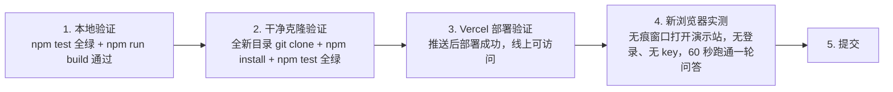

# AGENTS.md · FrankenMCP（Kiroween 2026）Agent 强制执行规范
> **项目定位**：Kiroween 2026 黑客松参赛项目，Frankenstein 类别，单人开发。公开开源仓库 `leethoneid/frankenmcp`。
> **适用范围**：本仓库中执行研发、文档、演示、提交任务的所有 AI Agent（Kiro、Antigravity 及其他）。
> **效力等级**：**最高优先级（Absolute Priority）**。与原《标的研发规范》冲突时，以本文为准——本项目是比赛作品，不是商业产品。
> **截止**：2026-12-04 14:00 PT（北京时间 12-05 06:00）。评审至 2027-01-29。

---

## 目录 (Table of Contents)
1. [核心研发工程六大军规 (Core Engineering Principles)](#一核心研发工程六大军规-core-engineering-principles)
2. [分阶段实施标准与技术规程 (Technical Implementation Guidelines)](#二分阶段实施标准与技术规程-technical-implementation-guidelines)
   - 2.1 [单轨开源与部署规范 (Single-Track OSS + Vercel)](#21-单轨开源与部署规范-single-track-oss--vercel)
   - 2.2 [商业代码禁入规范 (Commercial Code Stays Out)](#22-商业代码禁入规范-commercial-code-stays-out)
   - 2.3 [开源许可规范：只用 MIT (License: MIT Only)](#23-开源许可规范只用-mit-license-mit-only)
   - 2.4 [网络服务与默认防御 (Server Hardening)](#24-网络服务与默认防御-server-hardening)
   - 2.5 [数据诚信与基准测试公约 (Truth-in-Advertising)](#25-数据诚信与基准测试公约-truth-in-advertising)
   - 2.6 [开源 README 双语与无痕发布规范 (Bilingual & Clean Identity)](#26-开源-readme-双语与无痕发布规范-bilingual--clean-identity)
   - 2.7 [真实性铁律与防假成功规范 (No Fake Success)](#27-真实性铁律与防假成功规范-no-fake-success)
   - 2.8 [默认 Fail-Closed 安全规范 (Fail-Closed Defaults)](#28-默认-fail-closed-安全规范-fail-closed-defaults)
   - 2.9 [行为级测试与 PBT 规范 (Behavioral Testing + PBT)](#29-行为级测试与-pbt-规范-behavioral-testing--pbt)
   - 2.10 [修复验证与复审门禁 (Fix Verification)](#210-修复验证与复审门禁-fix-verification)
   - 2.11 [Kiro 使用规范 (Kiro Usage — Disqualification Risk)](#211-kiro-使用规范-kiro-usage--disqualification-risk)
   - 2.12 [新项目规则与旧代码披露 (New-Project Rule & Prior-Work Disclosure)](#212-新项目规则与旧代码披露-new-project-rule--prior-work-disclosure)
3. [多环境验证协议 (Multi-Environment Verification Protocol)](#三多环境验证协议-multi-environment-verification-protocol)
4. [提交强制核验门禁 (Pre-Submission Checklist)](#四提交强制核验门禁-pre-submission-checklist)

---

## 一、核心研发工程六大军规 (Core Engineering Principles)

### 军规 1：彻底审计，严禁密钥与商业代码入库 (Exhaustive Audit — No Secrets, No Commercial Code)
* **审计纵深**：凡涉及**密钥、Token、鉴权、商业 DRM、许可校验**的代码变动，必须逐行审计。仓库里出现以下任一即视为门禁失败：真实 API Key / Token、私钥文件、Ed25519 商业授权代码、Gumroad 鉴权代码、licence key 生成或校验逻辑。
* **反向旁路测试**：站在评审与攻击者视角验证：公开仓库干净克隆后，任何人能否在不提供任何密钥的情况下跑通演示；演示服务器是否会在无凭证时静默造假数据（见 2.7）。

### 军规 2：不得破坏既有依赖的契约 (Zero-Regression on the Router Dependency)
* **路由器是依赖，不是改造对象**：`mcp-dynamic-router` 以依赖形式引用，**严禁改它的代码、接口与行为**；适配一律在新仓库里包 adapter 层做。
* **契约兼容**：演示 MCP 服务器的工具名、输入输出 schema 一旦定下不得随意改；改了必须同步更新 `.kiro/settings/mcp.json`、仪表盘与文档。

### 军规 3：细致文档穷尽场景，文宣直击评审痛点 (Exhaustive Docs & Pain-Point Copy)
* **技术文档 (README)**：必须覆盖：这是什么、5 分钟跑起来、三个演示服务器怎么用、没有 key 也能跑、常见错误与 FAQ。评审打开仓库 60 秒内必须看懂项目是干什么的。
* **双语交付**：主版英文 `README.md`，中文版 `README.zh-CN.md`，顶部首行双向切换栏（见 2.6）。
* **提交文案 (Devpost)**：拒绝假大空。直接击中评审标准：真实用户故事（一个人用一个聊天框指挥整个业务栈）、实测数字（每轮裁掉多少工具、省多少上下文）、Kiro 用法（spec/hooks/steering/MCP/agents/PBT 各讲一个具体故事）。

### 军规 4：全域去敏防泄露，严禁出现本地环境与敏感信息 (Strict Privacy & Zero PII Leakage)
* **源码与文档去敏**：所有公开内容（源码、提交记录、README、截图、演示视频）中，**严禁出现真实个人敏感信息、本地绝对路径（如 `D:\AI\...`、`C:\Users\...`）、内部主机名、测试密钥、私有 Token**。
* **消除内部代号**：严禁出现“标的*”、“Target *”、商业产品内部代号；对外统一用正式项目名 `FrankenMCP`。
* **演示数据去敏**：演示用的笔记、待办、对话示例一律用通用占位内容，不得用真实业务数据。

### 军规 5：首分钟极速体验，杜绝评审配置挫败 (Frictionless Onboarding — Time-to-Value < 60s)
* **评委零配置**：打开 Vercel 链接，不注册、不填 key、不装任何东西，60 秒内看到三个演示服务器已连接、能问一句话、看到路由决策与裁剪数字。
* **杜绝配置挫败感**：严禁让评审陷入“克隆代码 -> 装环境 -> 编译 -> 调报错”；本地运行也必须是一条命令（`npm install && npm run dev`），README 顶部就写。

### 军规 6：跨平台与跨浏览器稳定运行 (Universal Compatibility)
* **Web 端**：Chrome / Edge / Safari / Firefox 均能正常打开演示站；移动端至少可读可用。
* **开发端**：代码、构建脚本必须在 Windows、Linux、macOS 下都能跑；严禁写死单一平台命令（`python` vs `python3`、反斜杠路径、单一 Shell 管道）。

---

## 二、分阶段实施标准与技术规程 (Technical Implementation Guidelines)

### 2.1 单轨开源与部署规范 (Single-Track OSS + Vercel)
1. **只有开源一轨**：本项目没有社区版/商业版双轨，只有一个公开开源仓库。原规范 2.1 的双轨、预编译 `dist/` 入库、打包四级容灾**全部不适用**。
2. **部署**：Vercel 从 Git 自动部署；`main` 分支必须永远可部署，推送即部署，部署失败立即修，不得留红。
3. **依赖安装**：路由器依赖通过 `npx -y github:leethoneid/mcp-dynamic-router serve` 引用（零编译、Node ≥20）；本项目本身用标准 `npm install`。

### 2.2 商业代码禁入规范 (Commercial Code Stays Out)
1. **禁入清单**（出现任一即门禁失败）：Ed25519 签发/验签代码、Gumroad API 调用、License Key 生成/校验、硬件指纹锁、代码混淆配置、任何“商用版”分支或开关。
2. **原规范 2.2（DRM）、2.3（渠道同步）、2.6（Gumroad）全部不适用**，不得把那三节的任何实现搬进本仓库。
3. **商业线隔离**：商业版（Gumroad Pro）继续走原有仓库与渠道，与本项目物理隔离；本仓库的 README、代码、提交记录中不得出现 Gumroad 商品链接、售价与购买引导。

### 2.3 开源许可规范：只用 MIT (License: MIT Only)
1. **许可模式定性**：本仓库实行标准 MIT 开源许可。**原规范 2.8“严禁写 MIT”在此项目中反转作废**——比赛规则要求“可检测的开源协议”，MIT 是唯一正确选择；写 PolyForm Noncommercial 会导致协议检测不认。
2. **LICENSE 文件必须是 MIT 全文**，不得保留 PolyForm 文本；README 顶部授权章节只写 MIT，不得写“个人免费、商用须购买”。
3. **路由器依赖的许可不受影响**：`mcp-dynamic-router` 自身保持 PolyForm Noncommercial，那份许可保留在它自己的仓库里；本仓库只在 README 的 Prior work 一节写明依赖关系，不复制、不改写它的许可文本。

### 2.4 网络服务与默认防御 (Server Hardening)
1. **演示站默认公开是设计如此**：Vercel 部署的演示应用本身就是给评审免登录访问的，不设鉴权；但**管理类与调试类端点不得暴露**，有的一律鉴权。
2. **密钥零默认值**：任何可选配置的 key（GitHub token 等）严禁设公开默认值；未配置时该功能明确显示“未配置”，不得静默用假数据顶替。
3. **传输与体量防御**：API 路由设请求体上限；token 只接受 `Authorization: Bearer` / `X-API-Key` 头，严禁 `?token=` 查询参数；CORS 默认只允许自有域名。

### 2.5 数据诚信与基准测试公约 (Truth-in-Advertising)
1. **仪表盘数字必须是真实运行算出来的**：每轮加载/裁剪的工具数、省下的 token 估算，必须从真实路由决策里统计，**严禁写死数字、严禁写死前后对比**。
2. **合成数据主动披露**：演示服务器的数据（笔记、待办）是程序生成的 fixture，必须在 UI 或文档里标注为演示数据；基准数字必须注明测量方式与环境。
3. **全局数据口径统一**：README、Devpost 提交、演示视频里的关键数字（工具数、裁剪比例、token 节省）必须一致，改动后全局搜索替换旧数字，0 残留。

### 2.6 开源 README 双语与无痕发布规范 (Bilingual & Clean Identity)
1. **主版英文必须作为默认入口**：根目录 `README.md` 必须默认英文；中文版统一为 `README.zh-CN.md`，结构与内容 100% 同步；顶部第 1 行双向切换栏：
   ```markdown
   [English](./README.md) | [简体中文](./README.zh-CN.md)
   ```
2. **README 必须包含**：一句话介绍、在线演示链接、60 秒上手、三个演示服务器说明、Prior work（路由器复用披露）、Kiro 用法简述、LICENSE（MIT）。
3. **本地内部代号彻底抹除**：README、文档、注释、提交信息中严禁出现“标的*”、“Target *”、商业产品内部代号。

### 2.7 真实性铁律与防假成功规范 (No Fake Success)
> 与原规范 2.9 并列最高优先级。演示仪表盘报假数字与备份工具报假成功是同一类缺陷。
1. **演示代码与生产代码物理隔离**：Mock / Demo / Synthetic 生成函数一律放在 `src/demo/` 内，**生产主路径严禁 import 演示目录**；演示模式由显式开关进入，演示输出必须带 `[DEMO]` 前缀或 UI 标注。
2. **成功文案以真实效果为准**：“已连接 / 调用成功 / 已保存”只允许在真实效果验证后输出；未验证时输出“未完成 / 未验证 / 失败 + 原因”，严禁输出未经验证的数字。
3. **失败必须大声失败（Fail Loud）**：MCP 服务器连不上、路由失败、工具调用失败时，UI 必须报错并说明原因，不得静默降级到 mock 数据继续跑出漂亮数字。
4. **合成数据三重标注**：程序生成的 fixture 必须同时满足代码注释标注、运行输出标注、文档标注。

### 2.8 默认 Fail-Closed 安全规范 (Fail-Closed Defaults)
1. **密钥无默认值**：任何密钥未配置时拒绝执行该操作并明确报错，不得注入临时密钥静默绕过。
2. **鉴权默认强制**：管理/调试端点默认必须鉴权；无 key 请求返回 401。
3. **网络默认收紧**：CORS 默认只允许自有域名，严禁 `*`；token 只接受 Header，严禁查询参数。
4. **落盘默认最小权限**：含凭证的文件写盘一律 `{ mode: 0o600 }`，目录 `0o700`；`.gitignore` 必须写 `.env*`。

### 2.9 行为级测试与 PBT 规范 (Behavioral Testing + PBT)
1. **测行为，不测 helper**：路由测试必须真实 spawn MCP 服务器子进程并断言路由决策；鉴权测试必须真实起 HTTP 服务断言 401/200；仪表盘测试必须断言数字来自真实运行统计。
2. **PBT 三条不变量（每条 ≥100 个 fast-check 用例）**：
   - 裁剪不丢必需参数；
   - 同一输入 + 同一服务器集合 → 同一路由决策；
   - tool schema 裁剪往返保真。
   每个 PBT 用例标注它验证的 `requirements.md` 条目编号。
3. **禁止静默跳过**：测试因缺环境跳过时输出必须打印 `[SKIPPED: 原因]`，且不计入通过数；README 的通过数字等于实跑数字。
4. **攻击者路径测试是必选项**：伪造工具 schema、越权调用、路径遍历、SSRF 内网地址至少各一组。

### 2.10 修复验证与复审门禁 (Fix Verification)
1. **修复必须带回归测试**：每个 bug 修复附带复现测试，先证明旧代码失败、再证明新代码通过。
2. **复审必须审入口**：从真实入口（聊天框提交、仪表盘刷新、MCP 连接）核对修复项，库函数修好但入口绕过的视为未修复。
3. **历史重写触发全量重审**：force-push / 变基后不得做 diff 复审，必须对新快照全量重审。

### 2.11 Kiro 使用规范 (Kiro Usage — Disqualification Risk)
> **规则原文**："Insufficient use of Kiro will result in disqualification at the Judges' sole discretion." 没有公开清单，评委自由裁量。**只挂一个空 `/.kiro` 目录、或全程用别的工具写代码再贴进来，等于直接出局。**
1. **分工铁律**：Kiro 定方向（spec、steering、hooks、agents），Antigravity 写实现（按确认后的 `tasks.md`）。**Antigravity 是手，Kiro 是脑，不得反过来。**
2. **spec 必须真实走 Kiro**：每个功能（router-core、monster-lab-dashboard、playground-chat、deployment）都在 Kiro 里生成 requirements.md（EARS 写法）→ design.md → tasks.md，逐个经人确认后才实现；需求变更回 Kiro 改 spec，不得在 Antigravity 里直接改需求。
3. **`/.kiro` 目录结构**（根目录，**严禁写进 `.gitignore`**）：
   ```
   .kiro/
     specs/<feature>/requirements.md | design.md | tasks.md
     steering/product.md | tech.md | structure.md
     hooks/<name>.json            # 必须真实触发（保存时 typecheck、mcp.json 变动时生成快照）
     settings/mcp.json            # 预配 notes / tasks / calculator 三个演示服务器
     agents/router-orchestrator.json
   ```
4. **写得出故事**：提交文案里每个 Kiro 功能都要讲一个具体故事（哪个 hook 自动化了什么、省了什么；哪个 MCP 服务器让什么功能成为可能；PBT 抓到过什么 unit test 漏掉的问题）。写不出来的等于没用过。
5. **禁止编造 Kiro 使用记录**：不得虚构 spec、hooks 触发记录、PBT 结果；Kiro credits 使用情况如实记录。

### 2.12 新项目规则与旧代码披露 (New-Project Rule & Prior-Work Disclosure)
1. **只接受新建项目**：参赛项目必须在 2026-10-30 至 2026-12-04 期间新建；10 月 30 日之前开始的项目没有资格。**改名、重建仓库、换壳都不能把旧项目变成新项目**。
2. **复用必须披露**：`mcp-dynamic-router` 作为依赖复用，在 README 的 Prior work 一节写明：路由器是作者已有的开源组件，本仓库除路由器外全部为比赛期间新建。
3. **商业项目不得参赛**：supabase-vault-sync、stripe-dunning-engine 等已有商业项目不得改名重建后参赛；只能像路由器一样作为新项目的依赖或灵感来源。

## 三、多环境验证协议 (Multi-Environment Verification Protocol)

发布前必须依次通过以下验证（原规范 instabox 环节不适用，改为 Vercel + 新浏览器实测）：



1. **环境 1：本地开发机**：`npm test` 全绿；`npm run build` 通过。
2. **环境 2：干净克隆**：全新目录 `git clone`，`npm install` + `npm test` 全绿（模拟评审从零检出）。
3. **环境 3：Vercel 线上**：推送后部署成功，线上演示站可访问，仪表盘数字真实。
4. **环境 4：新浏览器实测**：无痕窗口打开演示站，不登录、不填 key，60 秒内完成一次真实问答并看到路由决策。

---

## 四、提交强制核验门禁 (Pre-Submission Checklist)

提交 Devpost 前，Agent 必须按顺序严格核验以下 14 项门禁，**全部勾选方可提交**：

- [ ] **1. 全域敏感与编号排查**：`git grep` 确认全项目无私钥、测试密码、本地绝对路径、`?token=`、以及“标的*”或“Target *”等内部代号。
- [ ] **2. 商业代码禁入**：全库 grep 无 Ed25519、Gumroad API、License Key、混淆配置；README 无 Gumroad 链接、无售价。
- [ ] **3. 许可正确**：LICENSE 为 MIT 全文；README 顶部只写 MIT；路由器依赖的 PolyForm 仅出现在 Prior work 说明中。
- [ ] **4. 新项目合规**：仓库创建于 2026-10-30 之后；README 有 Prior work 披露；无旧项目改名重建痕迹。
- [ ] **5. `/.kiro` 完整**：根目录存在，含 specs / steering / hooks / settings/mcp.json / agents；**未写进 `.gitignore`**；hooks 真实触发过。
- [ ] **6. 本地完整构建**：`npm test` 全绿（含 PBT 三条不变量）；`npm run build` 通过。
- [ ] **7. 干净克隆验跑**：全新目录检出后 `npm install` + `npm test` 全绿。
- [ ] **8. Vercel 部署**：线上演示站可访问；无登录、无 key 即可跑通。
- [ ] **9. 60 秒实测**：无痕浏览器打开演示站，60 秒内完成一次真实问答，路由决策与裁剪数字可见且真实。
- [ ] **10. 默认 Fail-Closed 实测**：无 key 调用可选功能明确显示“未配置”；管理端无 key 返回 401；全库 grep 无公开默认密钥。
- [ ] **11. 演示代码不在生产路径**：生产入口可达的模块不引用 `demo/`、`mock`、`synthetic` 生成器；演示输出带 `[DEMO]` 标注；“成功”类文案均有真实效果凭据。
- [ ] **12. 双语文档**：`README.md` 为英文主版，`README.zh-CN.md` 存在且同步，顶部首行均含 `[English](./README.md) | [简体中文](./README.zh-CN.md)`。
- [ ] **13. 演示视频**：公开 YouTube，<3 分钟，展示真机运行，无第三方商标与版权音乐。
- [ ] **14. Kiro 用法说明**：Devpost 提交文案讲清 specs / hooks / steering / MCP / agents / PBT 各自的真实使用故事；类别选 Frankenstein；4,000 活动 credits 兑换码（如已收到）须在 12-04 前兑换。
